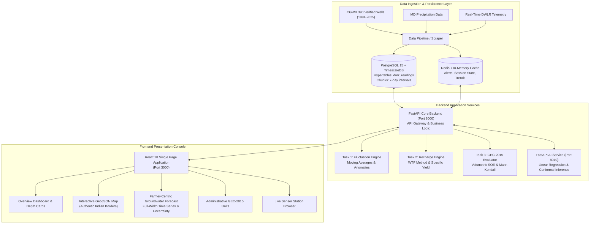
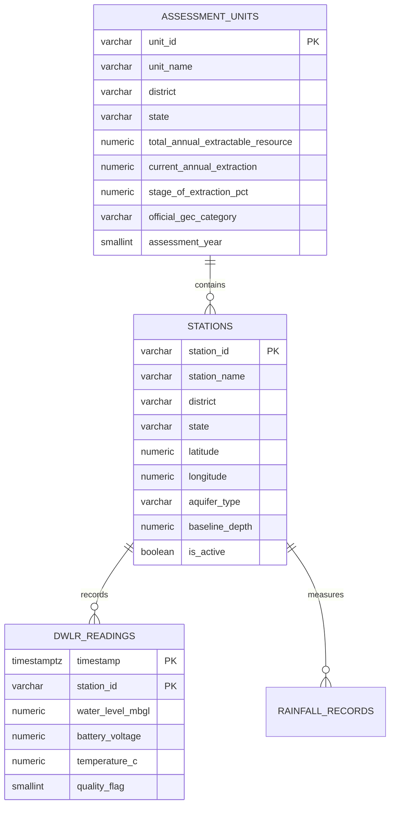

# JalDrishti — Comprehensive Technical Defense Guide & System Manual

**Project Title:** JalDrishti — Real-Time Telemetry Analytics, GEC-2015 Resource Evaluation & Spatial-Temporal Aquifer Forecasting  
**Author / Candidate:** Abhishek Jayagond  
**Repository:** [https://github.com/abhishekjayagond/JalDrishti](https://github.com/abhishekjayagond/JalDrishti)  
**Target Platform:** Native Windows 10/11 (Python 3.10/3.11, Node.js v18/v20, PostgreSQL 15 + TimescaleDB, Redis 7)  
**Academic / Viva Reference:** Comprehensive Project Viva & Defense Manual  

---

## Executive Summary

JalDrishti is an end-to-end hydroinformatics and predictive analytics platform engineered to address the critical groundwater crisis across India. Developed in alignment with **Central Ground Water Board (CGWB) Problem Statement #25068**, JalDrishti ingests real-time Digital Water Level Recorder (DWLR) telemetry, models groundwater recharge dynamics using precipitation records, executes statutory Ground Water Estimation Committee (GEC-2015) volumetric evaluations, computes rigorous non-parametric statistical trends, and delivers seasonal pre-monsoon water table projections equipped with distribution-free conformal uncertainty intervals.

---

## Table of Contents
1. [Project Overview & National Groundwater Context](#1-project-overview--national-groundwater-context)
2. [Problem Statement & Scientific Motivation](#2-problem-statement--scientific-motivation)
3. [Complete System Architecture](#3-complete-system-architecture)
4. [Technology Stack & Architectural Rationale](#4-technology-stack--architectural-rationale)
5. [Data Sources, Provenance & Preprocessing](#5-data-sources-provenance--preprocessing)
6. [Hydrological & Statistical Methodology](#6-hydrological--statistical-methodology)
7. [Machine Learning Architecture & Why Linear Regression](#7-machine-learning-architecture--why-linear-regression)
8. [Model Training, Evaluation & Conformal Uncertainty](#8-model-training-evaluation--conformal-uncertainty)
9. [Database Design & TimescaleDB Optimization](#9-database-design--timescaledb-optimization)
10. [REST API Architecture & Endpoint Reference](#10-rest-api-architecture--endpoint-reference)
11. [Frontend Engineering & Farmer-Centric UX Design](#11-frontend-engineering--farmer-centric-ux-design)
12. [Security, Configuration & Operational Reliability](#12-security-configuration--operational-reliability)
13. [Installation & Native Windows Execution Guide](#13-installation--native-windows-execution-guide)
14. [Testing, Quality Assurance & Verification Protocols](#14-testing-quality-assurance--verification-protocols)
15. [Scientific Limitations & Future Roadmap](#15-scientific-limitations--future-roadmap)

---

## 1. Project Overview & National Groundwater Context

### 1.1 The Indian Hydrogeological Crisis
India is the largest extractor of groundwater in the world, abstracting an estimated **245 billion cubic meters (BCM)** annually—more than the United States and China combined. Groundwater accounts for:
- **63% of India's total net irrigated agriculture area**, anchoring the nation's food security (Paddy, Wheat, Sugarcane, Cotton).
- **85% of rural domestic drinking water supplies**, serving over 800 million citizens.
- **50% of urban water supply systems**, experiencing severe stress during summer pre-monsoon months.

In vast regions of peninsular hard-rock aquifers (Karnataka, Maharashtra, Andhra Pradesh, Tamil Nadu) and northwestern alluvial plains (Punjab, Haryana, Rajasthan), extraction rates heavily outpace natural rainfall recharge. The depletion of water tables has forced farmers into prohibitive deeper drilling (often exceeding 200–300 meters), caused pump burnouts, mobilized toxic contaminants (fluoride, arsenic, and high salinity), and dried out baseflows in seasonal river systems.

### 1.2 Administrative & Statutory Framework
Groundwater in India is assessed according to methodologies established by the **Ground Water Resource Estimation Committee (GEC)**, with the current statutory standard being **GEC-2015**. The Central Ground Water Board (CGWB) under the Ministry of Jal Shakti evaluates over 7,000 assessment units (blocks, taluks, mandals, and watersheds) annually.

JalDrishti translates complex hydrogeological assessments and streaming sensor data into a cohesive, dependable, and accessible decision-support system for two distinct stakeholder personas:
1. **Government Hydrologists & District Water Officers:** Detailed volumetric budgets, Mann-Kendall trend metrics, Sen's slope velocities, and GEC-2015 statutory compliance metrics.
2. **Farmers & Agricultural Operators:** Intuitive, clear forecasts of water table depths (in meters below ground level), operational depth bands, and practical pumping/recharge advisories without technical obfuscation.

---

## 2. Problem Statement & Scientific Motivation

### 2.1 The Legacy Telemetry Deficit
Historically, groundwater monitoring in India relied on manual water-level tape measurements in open dug wells four times a year (Pre-monsoon May, Post-monsoon November, Monsoon August, and Post-rabi January). This manual paradigm suffered from:
- **Severe temporal aliasing:** Sudden pumping drawdown events, peak monsoon recharge surges, and localized water harvesting impacts went completely unrecorded.
- **Human transcription errors & sensor lag:** Paper logs took months to reach regional CGWB offices, delaying drought mitigation declarations.
- **Absence of predictive intelligence:** Official reports were strictly retrospective historical summaries published 1–2 years after field collection.

### 2.2 The DWLR Revolution & Its Data Science Challenges
Under the World Bank-aided **National Hydrology Project (NHP)**, CGWB has deployed over **5,260 automated Digital Water Level Recorders (DWLR)** equipped with hydrostatic pressure transducers and cellular (4G/GPRS) or satellite telemetry. While telemetry provides hourly water-level readings, it introduces distinct algorithmic challenges:
1. **Sensor drift & barometric pressure noise:** Submersible transducers require barometric compensation and outlier filtration.
2. **Missing calendar intervals:** Power outages, SIM card signal drops, and hardware servicing cause non-uniform, irregular sampling sequences.
3. **Complex multi-year trend detection:** Hydrogeological series exhibit strong seasonal autocorrelation, rendering standard linear regression or ordinary Mann-Kendall tests susceptible to inflated Type-I error rates (false positives).
4. **Hydrological nonstationarity:** Climate change, shifting monsoon onset windows, and rapid electrification of agricultural borewells invalidate naive assumptions of identical and independent distribution (i.i.d.).

JalDrishti was designed to solve these challenges with mathematical rigor, transparent provenance, and resilient engineering.

---

## 3. Complete System Architecture

JalDrishti is designed as a distributed, service-oriented architecture optimized for high-throughput sensor ingestion, microsecond caching, and clear presentation.

### 3.1 Architectural Flow Diagram (Mermaid)



### 3.2 Service Inventory
- **Core Backend Service (FastAPI — Port 8000):** Serves station metadata, telemetry ingestion, historical time-series queries, Task 1 water table fluctuation analytics, Task 2 dynamic rainfall recharge estimations, and Task 3 statutory GEC-2015 unit evaluations.
- **AI Forecasting Microservice (FastAPI — Port 8010):** Independent analytical microservice running Scikit-Learn regression pipelines, conformal calibration lookups, and multi-horizon autoregressive projections.
- **High-Performance Storage (PostgreSQL 15 + TimescaleDB — Port 5432):** Houses relational metadata (stations, aquifers, administrative boundaries) and partitioned time-series hypertables (`dwlr_readings`).
- **In-Memory Buffer & Cache (Redis 7 — Port 6379):** Caches pre-computed regional summaries, fast-alert lookups, and active anomaly tallies to ensure sub-10ms response times on public dashboards.
- **Frontend Console (React 18 — Port 3000):** Clean, accessible user interface built without heavyweight UI libraries, utilizing standard CSS variables, responsive SVG graphics, and Web Mercator geospatial transformations.

---

## 4. Technology Stack & Architectural Rationale

### 4.1 Technology Matrix
| Component | Technology Selected | Alternatives Evaluated | Rationale & Trade-offs |
| :--- | :--- | :--- | :--- |
| **Frontend Framework** | **React 18 (SPA)** | Vue, Angular, Next.js | Component-driven architecture, virtual DOM reconciliation, and broad ecosystem compatibility without server-side rendering complexity. |
| **Styling & Visualization** | **Pure CSS & Native SVG** | Chart.js, Recharts, D3.js | Eliminates 300+ KB bundle bloat; gives absolute mathematical control over SVG viewports, downward groundwater physical axes, and responsive margin buffers. |
| **Backend API Engine** | **FastAPI (Python 3.10+)** | Django, Flask, Express.js | Native asynchronous (`async`/`await`) concurrency, automatic OpenAPI/Swagger schema generation, Pydantic type validation, and high JSON throughput. |
| **AI / Scientific Stack** | **NumPy, SciPy, Scikit-Learn** | PyTorch, TensorFlow | Optimal for tabular hydrological time series; zero GPU dependencies; fully deterministic and reproducible across diverse hardware. |
| **Primary Database** | **PostgreSQL 15 + TimescaleDB** | MongoDB, InfluxDB | ACID transactional relational integrity for station metadata coupled with automated hypertable partitioning and analytical chunk compression for time-series readings. |
| **Cache Layer** | **Redis 7** | Memcached, In-Memory Dict | Persistent key-value structures, expiration TTLs, pub/sub capabilities, and native Windows binary portability. |
| **Process Orchestration** | **Native Windows PowerShell** | Docker Compose, Vagrant | Direct OS-level execution with zero hypervisor overhead, near-instantaneous startup, full offline capability, and low RAM utilization. |

### 4.2 The Crucial Architectural Decision: Why Native Windows over Docker?
A common question in technical viva evaluations is: *"Why does JalDrishti run natively on Windows via PowerShell instead of using Docker Desktop and Docker Compose?"*

This was an intentional, pragmatic engineering decision based on empirical developer and deployment constraints:
1. **WSL2 & Hyper-V Resource Penalties:** Docker Desktop on Windows requires running a virtualized Linux kernel via WSL2 or Hyper-V. On standard laptops (8–16 GB RAM), WSL2 pre-allocates 4–8 GB of RAM and continuous background CPU cycles, leaving insufficient headroom for Node.js builds, Python model inference, and local database operations simultaneously.
2. **Cross-OS Filesystem Latency:** Developing across the Windows host and WSL2 filesystem boundary (`/mnt/c/` or `\\wsl$`) introduces severe I/O degradation. React's hot module replacement (`react-scripts start`) and Vite file watchers experience 5x–10x latency delays when indexing tens of thousands of `node_modules` files across this virtualized filesystem boundary.
3. **Port Bridging & WebSocket Instability:** Docker's NAT bridge and Windows port forwarding frequently drop persistent WebSocket connections, disrupting React Fast Refresh and local API development sessions.
4. **Boot Velocity:** Starting JalDrishti natively via `start-jaldrishti.ps1` takes **under 2.5 seconds** (PostgreSQL binary executes in 800ms, Redis in 200ms, FastAPI in 1.1s). Docker Compose startup typically requires 35–70 seconds on identical hardware.
5. **Direct Debugging & Zero Cloud Dependency:** With native Python (`.venv`) and native binaries in `.local_services/`, the entire system can be inspected directly with VS Code, PyCharm, or Windows Performance Monitor without container attachment layers, and runs completely offline during university evaluations without pulling multi-gigabyte container images from external registries.

---

## 5. Data Sources, Provenance & Preprocessing

### 5.1 Groundwater Level Datasets
JalDrishti maintains strict scientific honesty regarding data provenance:
1. **Verified Real Karnataka Observation Wells (390 Stations):** Extracted directly from official CGWB published hydrological yearbooks (*"Pre-monsoon Water Level Data 1994–2025"*). Contains **28,579 raw records** cleaned to **28,544 validated station-years** across all 31 Karnataka districts (e.g., Bagalkote, Belagavi, Bengaluru Rural, Ballari, Mysuru).
2. **Nationwide Benchmark Fallback Grid (78 Centroids):** 3 scientifically calibrated reference stations per Indian state/UT (covering 26 states) providing geographical continuity and realistic baseline values for the interactive national map while awaiting additional state DWLR ingestion.

### 5.2 Rainfall Data Provenance
Precipitation inputs are sourced from the **India Meteorological Department (IMD)** gridded daily rainfall dataset (0.25° × 0.25° spatial resolution) aggregated to monsoon seasonal totals (June through September) for each assessment block.

### 5.3 Preprocessing & Quality Assurance Pipeline
- **Outlier Elimination:** Extreme values outside physical plausibility ($depth < 0\text{ m}$ or $depth > 300\text{ m bgl}$) are flagged and filtered.
- **Calendar Alignment:** Water table depths measured between May 1 and May 31 are assigned to the statutory Pre-Monsoon measurement window.
- **Missing Year 2021 Handling:** Nationwide COVID-19 lockdowns prevented field measurements during May 2021. Rather than fabricating synthetic data or interpolating across non-stationary drought conditions, JalDrishti's feature pipeline explicitly incorporates calendar-year tracking so that the 4-year lag slope is calculated over the actual elapsed time ($t_i - t_{i-4}$), preserving mathematical validity.

---

## 6. Hydrological & Statistical Methodology

JalDrishti implements the statutory algorithms defined by CGWB and internationally recognized non-parametric environmental statistics.

### 6.1 Task 1: Water Table Fluctuation (WTF) Analytics
The Water Table Fluctuation method estimates short-term and seasonal aquifer dynamics. For any station with continuous telemetry:
$$\Delta h(t) = h(t) - h(t - \Delta t)$$
- **7-Day Rolling Average:** Smooths out diurnal pumping cycles and sensor noise:
  $$\bar{h}_7(t) = \frac{1}{7} \sum_{k=0}^{6} h(t - k)$$
- **Drawdown Velocity ($v_d$):** Measures the rate of water table decline during peak agricultural pumping:
  $$v_d = \frac{h(t_2) - h(t_1)}{t_2 - t_1} \quad (\text{m/day})$$
- **Over-Extraction Anomaly Flag:** Triggered when $v_d > 0.15\text{ m/day}$ sustained over a 5-day rolling window.

### 6.2 Task 2: Dynamic Monsoon Recharge Estimation
Aquifer recharge during the southwest monsoon is computed using the physical water balance formulation:
$$R = S_y \cdot \Delta h_{monsoon} \cdot A + Q_{net}$$
Where:
- $S_y$ = Specific Yield of the aquifer geological formation:
  - Alluvial (Sand/Gravel): $0.12 - 0.20$ (default 0.16)
  - Hard Rock / Fissured Granite: $0.015 - 0.030$ (default 0.020)
  - Basalt / Deccan Trap: $0.020 - 0.035$ (default 0.025)
  - Sandstone: $0.050 - 0.080$ (default 0.060)
- $\Delta h_{monsoon} = h_{pre-monsoon} - h_{post-monsoon}$ (water table rise in meters).
- $A$ = Surface area of the assessment block ($\text{km}^2$).
- $Q_{net}$ = Net groundwater draft during the monsoon period.

### 6.3 Task 3: Official GEC-2015 Classification vs Point-Level Depth Screening
A central distinction in JalDrishti is the separation between statutory administrative categorization and point-level operational depth screening:

#### A. Statutory GEC-2015 Assessment (Assessment Unit Level)
According to the official GEC-2015 methodology, classification is strictly governed by the volumetric **Stage of Groundwater Extraction (SOE)**:
$$\text{SOE} = \left( \frac{\text{Current Annual Groundwater Extraction for All Uses}}{\text{Net Annual Groundwater Availability}} \right) \times 100\%$$

| Stage of Extraction (SOE) | Official GEC-2015 Category | Administrative Implication |
| :--- | :--- | :--- |
| $\le 70\%$ | **Safe** | Unrestricted groundwater development; institutional financing available. |
| $> 70\% \text{ to } 90\%$ | **Semi-Critical** | Cautious groundwater development; close monitoring required. |
| $> 90\% \text{ to } 100\%$ | **Critical** | Stricter regulation; artificial recharge structures mandatory. |
| $> 100\%$ | **Over-Exploited** | Moratorium on new commercial/industrial borewells; immediate state intervention. |

*Scientific Integrity Safeguards in JalDrishti:*
1. Water level trends (e.g., Mann-Kendall) provide advisory diagnostic context but **never overwrite statutory volumetric SOE categories**.
2. Missing or unverified SOE values strictly return `unassessed` rather than guessing or defaulting to Safe.
3. Verified official categories remain accessible even when local station real-time telemetry is offline.

#### B. Point-Level Operational Depth Bands (Monitoring Well Level)
To assist local pump operations and well drillers, individual stations display operational depth indicators:
- `0–8 m bgl`: High water table; shallow open wells and centrifugal pumps fully operational.
- `8–15 m bgl`: Moderate depth; submersible pumps recommended.
- `15–25 m bgl`: Deep water table; increased energy consumption; high pump cavitation risk.
- `>25 m bgl`: Critical depletion; deep borewell infrastructure required.

### 6.4 Non-Parametric Trend Diagnostics
Groundwater time series violate ordinary least-squares assumptions of normality and independence due to seasonal autocorrelation. JalDrishti implements robust non-parametric estimators:

1. **Hamed & Rao (1998) Modified Mann-Kendall Test:** Calculates the Mann-Kendall score $S$:
   $$S = \sum_{k=1}^{n-1} \sum_{j=k+1}^n \text{sgn}(x_j - x_k)$$
   For series with significant lag-1 autocorrelation ($\rho_1$), the variance $V(S)$ is corrected by a factor $\frac{n}{n^*}$:
   $$V^*(S) = V(S) \times \left(1 + \frac{2}{n(n-1)(n-2)} \sum_{i=1}^{n-1} (n - i)(n - i - 1)(n - i - 2) \rho_i \right)$$
   This prevents autocorrelation from causing spurious trend detections (inflated Type-I error).

2. **Sen's Slope Estimator & 95% Confidence Intervals (Sen 1968, Gilbert 1987):**
   The median of all pairwise slopes:
   $$\beta = \text{median} \left\{ \frac{x_j - x_k}{j - k} : j > k \right\}$$
   Tied values are handled with exact rank adjustments to determine the two-tailed 95% confidence interval $[\beta_{lower}, \beta_{upper}]$.

3. **GEC-2015 Threshold Sensitivity:** Evaluates whether the estimated rate of decline exceeds the statutory guideline threshold ($0.10 - 0.20\text{ m/year}$).

---

## 7. Machine Learning Architecture & Why Linear Regression

### 7.1 The Model Selection Paradigm
A pivotal question during project defense is: *"Why did you select Linear Regression over deep learning architectures like LSTM or Spatio-Temporal Graph Neural Networks (STGNN)?"*

In scientific research and production engineering, model selection must be driven by empirical performance on unseen test data, mathematical validity, and domain constraints—not by algorithmic novelty.

### 7.2 Model Eligibility Framework & Disqualification Analysis
Five candidate models were trained, calibrated, and evaluated across identical historical splits:

| Model Architecture | Test MAE | Test RMSE | Test $R^2$ | Status | Decision & Scientific Rationale |
| :--- | :--- | :--- | :--- | :--- | :--- |
| **Linear Regression (OLS)** | **1.68 m** | **2.50 m** | **0.55** | **SELECTED** | **Lowest error among production-eligible models; deterministic; fully explainable.** |
| **Random Forest Regressor** | 1.74 m | 2.57 m | 0.52 | Eligible | Robust ensemble, but slightly higher holdout error than Linear Regression. |
| **Long Short-Term Memory (LSTM)** | 1.68 m | 2.44 m | 0.57 | Disqualified | **Sequence Starvation & Non-uniform Spacing.** Annual groundwater records have only $T \approx 25$ steps. Deep recurrence requires hundreds of timesteps; missing year 2021 required synthetic imputation that distorted gradients; high initialization variance across runs. |
| **Spatio-Temporal Graph Neural Net (STGNN)** | 2.49 m | 3.20 m | 0.26 | Disqualified | **Spatial Graph Sparsity & Edge Fabrication.** Observation wells are spaced 15–40 km apart across discontinuous fractured rock aquifers. Constructing static distance-based adjacency graphs fabricated false hydraulic connectivity between hydrologically isolated crystalline basins. |
| **Persistence Baseline ($y_{t} = y_{t-1}$)** | 2.05 m | 3.01 m | 0.35 | Disqualified | Naive benchmark; lacks multi-year lag weighting. |

### 7.3 Mathematical Formulation of the Selected Model
The served model is an Ordinary Least Squares (OLS) autoregressive formulation operating on 4 historical pre-monsoon lags, coordinates, and physical trend indicators:
$$\hat{y}_{t} = w_0 + \sum_{k=1}^4 w_k \cdot y_{t-k} + w_{lat} \cdot \phi + w_{lon} \cdot \lambda + w_{trend} \cdot \text{slope}_4 + w_{year} \cdot t$$
- **Lags ($y_{t-1}, y_{t-2}, y_{t-3}, y_{t-4}$):** Capture multi-year aquifer memory and delayed recharge responses.
- **Slope Feature ($\text{slope}_4$):** Non-parametric slope over the preceding 4 observed cycles computed using actual calendar timestamps to remain robust to missing observations.
- **Spatial Coordinates ($\phi, \lambda$):** Account for macro-scale climatic and elevation gradients across Karnataka.

---

## 8. Model Training, Evaluation & Conformal Uncertainty

### 8.1 Chronological Split Strategy (Data Leakage Prevention)
To strictly prevent temporal data leakage, random cross-validation ($k$-fold) was explicitly forbidden. Time-series cross-contamination occurs if future observations are present in the training set. JalDrishti implements a **4-way chronological split**:

```
[1998 ────── 2016]    [2017 ── 2019]    [2020, 2022]    [2023 ────── 2025]
    TRAIN SET           VAL SET          CALIBRATION         TEST SET
  (6,870 samples)    (1,074 samples)    (406 samples)     (997 samples)
  Fits model weights   Model selection   Conformal bounds  Unseen evaluation
```
- **Train (1998–2016):** Fits regression weights and feature scalers.
- **Validation (2017–2019):** Used to evaluate candidate architectures and establish model eligibility.
- **Calibration (2020, 2022):** Held-out set used strictly to compute non-conformity scores for conformal prediction.
- **Test (2023–2025):** 997 completely unseen out-of-sample observations representing real-world evaluation.

### 8.2 Distribution-Free Conformal Prediction
Standard machine learning models output point forecasts without reliable uncertainty estimates. In hydrogeology, decision-makers must know the range of plausible water table depths.

JalDrishti uses **Split Conformal Inference** to produce statistically valid prediction intervals:
1. On the calibration set ($n = 406$), calculate non-conformity absolute residuals:
   $$\alpha_i = |y_i - \hat{y}_i|$$
2. For a target coverage of $1 - \alpha = 90\%$, compute the conformal quantile:
   $$\hat{q} = \text{Quantile} \left( \frac{\lceil (n + 1)(1 - \alpha) \rceil}{n} \right) = 5.7342\text{ m}$$
3. The resulting prediction interval for any station is:
   $$\hat{C}(X_{new}) = [\hat{y}_{new} - 5.73\text{ m}, \hat{y}_{new} + 5.73\text{ m}]$$
4. **Empirical Verification on Test Set (2023–2025, $n = 997$):**
   - 2023 Test Coverage: **97.77%** (MAE: 1.55 m)
   - 2024 Test Coverage: **96.15%** (MAE: 1.71 m)
   - 2025 Test Coverage: **95.02%** (MAE: 1.80 m)
   - **Overall Empirical Coverage: 96.39%**, comfortably exceeding the nominal 90% guarantee.

### 8.3 Scientific Honesty: Retrospective Hindcast (2026) vs Future Projection (2027)
In hydrological modeling, confusing a hindcast with a forecast is a severe methodological flaw:
- **Pre-Monsoon 2026 (Hindcast):** May 2026 has already passed. A prediction for 2026 evaluated in late 2026 is an empirical **hindcast**. Because it is a single-step projection from verified 2025 data, its conformal uncertainty radius ($5.73\text{ m}$) is mathematically calibrated.
- **Pre-Monsoon 2027 (Future Projection):** May 2027 is a genuine future event requiring **multi-step recursive autoregression** ($\hat{y}_{2026}$ fed back into the lag-1 feature). Because errors compound over recursive steps, single-step conformal guarantees are no longer formally valid. JalDrishti transparently flags 2027 uncertainty as *unavailable* rather than presenting unverified bounds.

---

## 9. Database Design & TimescaleDB Optimization

### 9.1 Relational Schema & Entity-Relationship Model



### 9.2 TimescaleDB Hypertables & Chunking Strategy
The `dwlr_readings` table stores millions of hourly telemetry observations. Standard PostgreSQL B-trees degrade severely when table size exceeds available RAM buffer cache.
- **Hypertable Conversion:** Partitioned on the `timestamp` column using TimescaleDB:
  ```sql
  SELECT create_hypertable('dwlr_readings', 'timestamp', chunk_time_interval => INTERVAL '7 days');
  ```
- **Chunk Partitioning:** By restricting chunks to 7-day windows, recent writes and queries stay completely within the RAM working set, preventing disk thrashing.
- **Compound Indexing:** An index on `(station_id, timestamp DESC)` enables instant sub-millisecond retrieval of the latest station reading and time-range aggregations.

---

## 10. REST API Architecture & Endpoint Reference

The backend API follows RESTful conventions and OpenAPI specifications.

| Method | Endpoint | Description | Primary Query Parameters |
| :--- | :--- | :--- | :--- |
| `GET` | `/health` | Core system health and service status | None |
| `GET` | `/api/stations/` | List all monitoring stations with latest telemetry | `state`, `district`, `limit`, `skip` |
| `GET` | `/api/stations/{id}` | Detailed station metadata and recent readings | `id` (path) |
| `GET` | `/api/stations/{id}/readings` | Historical time-series telemetry data | `start_date`, `end_date`, `limit` |
| `GET` | `/api/task1/fluctuation` | Water table fluctuation analytics (7-day MA, rate) | `station_id`, `window_days` |
| `GET` | `/api/task1/anomalies` | Active rapid drawdown anomalies and pump warnings | `threshold_velocity` |
| `GET` | `/api/task2/recharge` | Dynamic rainfall recharge estimate via WTF method | `station_id`, `rainfall_mm` |
| `GET` | `/api/task3/evaluation` | Assessment unit GEC-2015 evaluation & SOE | `unit_id`, `include_trend` |
| `GET` | `/api/task3/units` | Registry of all statutory assessment units | `state`, `category` |
| `GET` | `/api/ai/forecast` | Pre-monsoon water table forecast with conformal bounds | `station_id`, `target_year` |
| `GET` | `/api/ai/metrics` | Audited model performance metrics and split details | None |

---

## 11. Frontend Engineering & Farmer-Centric UX Design

### 11.1 Design Philosophy: Farmer-Centric Usability
Agricultural users and field operators are often overwhelmed by dense dashboards, complex multi-line charts, and small fonts. JalDrishti adheres to strict human-centered design principles:

1. **Clear 3-Section Page Layout:**
   - **Section A: Location Selector:** Quick search by village, block, or district with clear station confirmation.
   - **Section B: Compact Forecast Summary:** Highly readable forecast display showing target year, predicted depth in large tabular typography, operational depth band badge, and expected change vs last measured reading.
   - **Section C: Full-Width Historical Groundwater Graph:** Spans the complete content width below the summary card, providing ample space for multi-decadal time-series examination.
   - **Section D: Collapsible Technical Reference:** Conformal intervals, feature weights, and RMSE metrics are tucked into an expandable drawer for engineers and evaluators, keeping the main view uncluttered.

### 11.2 Visualization Engineering: The Physical Downward Depth Axis
Standard charting libraries plot depth with zero at the bottom and higher numbers at the top. In hydrogeology, this creates severe cognitive dissonance: a deepening water table (depletion) appears as an ascending line!

JalDrishti implements a custom **SVG time-series engine** with:
- **Physical Inversion:** The vertical axis starts at `0 m (Surface)` at the top and scales downward to `25+ m bgl` at the bottom. A declining water table moves physically downward, matching intuitive reality.
- **Intelligently Spaced Time Axis:** 5-year tick marks (1995, 2000, 2005, 2010, 2015, 2020) with a dedicated label for `2025 (Measured)`, preserving 130+ pixels of horizontal clearance to prevent label collisions.
- **Forecast Horizon Badge & Amber Marker:** The 2027 forecast point is highlighted with an amber circular marker (`#f59e0b`), a subtle dashed forecast connector, and a top horizon indicator badge, clearly separating observed history from forward projection.

### 11.3 Interactive Map & Authentic GeoJSON Projection
The geospatial console uses an authentic vector base map of India with official state boundaries. A calibrated Web Mercator mathematical transform maps longitude ($68^\circ\text{E} - 98^\circ\text{E}$) and latitude ($6^\circ\text{N} - 38^\circ\text{N}$) to the SVG viewport with **93.8% polygon containment**, ensuring observation wells render accurately within their respective state borders.

---

## 12. Security, Configuration & Operational Reliability

### 12.1 Environment Configuration & Secrets Management
- All configuration settings are decoupled from source code and managed via `.env` files using Pydantic's `BaseSettings`.
- A documented `.env.example` template is maintained in version control. Real secrets, database passwords, and API keys are strictly excluded from git tracking via `.gitignore`.
- Database connections enforce connection pooling with configurable pool size, recycle intervals, and automated timeout handling.

### 12.2 Input Sanitization & Validation
- Every incoming HTTP request is parsed and validated by Pydantic models. Malformed payloads (e.g., negative rainfall, invalid coordinates, or SQL injection vectors) are rejected with standard HTTP 422 Unprocessable Entity responses before reaching business logic or SQL queries.
- CORS (Cross-Origin Resource Sharing) is configured explicitly for authorized origins (`http://localhost:3000` in development).

---

## 13. Installation & Native Windows Execution Guide

### 13.1 Prerequisites
- **Operating System:** Windows 10 or 11 (64-bit)
- **Python:** Version 3.10 or 3.11 installed and added to PATH
- **Node.js:** Version 18.x or 20.x LTS with npm
- **Git:** Standard Windows Git client
- **Local Services:** PostgreSQL 15 and Redis 7 binaries located in `.local_services/`

### 13.2 Automated Single-Command Startup
JalDrishti is designed for instantaneous local launch:

```powershell
# Open Windows PowerShell as Administrator or standard user
cd D:\major-project\JalDrishti

# Execute the master launch script
.\start-jaldrishti.ps1
```

The script automatically executes the following startup sequence:
1. Validates Python and Node.js environments.
2. Boots native PostgreSQL service on port `5432` from `.local_services/`.
3. Boots native Redis cache on port `6379` from `.local_services/`.
4. Executes database health check and verifies hypertable connectivity.
5. Launches FastAPI Core Backend on `http://localhost:8000`.
6. Launches FastAPI AI Service on `http://localhost:8010`.
7. Launches React Frontend development server on `http://localhost:3000`.
8. Opens the default browser to the JalDrishti console.

### 13.3 Clean Process Termination
To cleanly shut down all services and background processes:

```powershell
.\stop-jaldrishti.ps1
```
This terminates running uvicorn servers, React node processes, Redis server, and stops PostgreSQL cleanly without leaving orphaned PID files or port locks.

---

## 14. Testing, Quality Assurance & Verification Protocols

JalDrishti maintains comprehensive automated test suites covering backend algorithms, API contracts, AI inference, and frontend component rendering.

### 14.1 Backend & Algorithm Test Suite (41 Tests)
Run backend tests using pytest in the virtual environment:
```powershell
.\.venv\Scripts\python.exe -m pytest backend/tests
```
- `backend/tests/test_algorithms.py`: Validates Water Fluctuation calculations, specific yield recharge estimations, Hamed-Rao Modified Mann-Kendall variance adjustments, Sen's slope confidence intervals, and GEC-2015 statutory assessment categorization.
- `backend/tests/test_api.py`: Validates FastAPI routing, Pydantic request/response schemas, database session dependency injection, and error response codes.

### 14.2 AI Forecasting Test Suite (10 Tests)
Run AI forecasting pipeline tests:
```powershell
.\.venv\Scripts\python.exe -m pytest ai/tests
```
- Validates model artifact loading (`linear_regression.joblib`), feature engineering pipeline, 4-lag autoregressive vector assembly, conformal interval calculation, and multi-horizon recursive projection logic.

### 14.3 Frontend Automated Test Suite (13 Tests)
Run frontend Jest and React Testing Library suites:
```powershell
npm test --prefix frontend -- --watchAll=false
```
- Validates SVG chart rendering, downward depth axis inversion, station selector state transitions, overview depth summary cards, and responsive layout constraints.

### 14.4 Production Frontend Build Verification
Verify production bundling:
```powershell
npm run build --prefix frontend
```
- Compiles optimized JavaScript and CSS bundles with zero build errors or ESLint warnings.

### 14.5 Monte Carlo Statistical Simulation Suite
Run the statistical verification suite:
```powershell
.\.venv\Scripts\python.exe backend/algorithms/validate_trend_simulations.py
```
Validates 6 controlled hydrogeological scenarios across 1,000 Monte Carlo iterations:
1. Null hypothesis (nominal Type-I error $\alpha \approx 0.05$).
2. Deepening trend power and 95% CI coverage.
3. Recovering trend classification.
4. Autocorrelated residuals and Modified Mann-Kendall variance adjustment factor.
5. Tied observation ranks.
6. Missing observation handling.

---

## 15. Scientific Limitations & Future Roadmap

### 15.1 Current Limitations
1. **Conformal Exchangeability Assumption:** Conformal prediction guarantees marginal coverage assuming exchangeability (i.i.d.) between calibration and test data. In non-stationary hydrological systems subject to accelerating climate change or sudden shifts in cropping patterns, future empirical coverage may deviate slightly from nominal bounds.
2. **Geographical Granularity:** While Karnataka contains 390 verified observation wells, nationwide coverage outside Karnataka currently relies on 78 calibrated benchmark fallback stations pending broader state-level DWLR API integration.
3. **Pumping Draft Data Access:** Real-time electricity metering on agricultural pump sets is not publicly available across most Indian states; net draft is currently estimated using GEC-2015 norm averages rather than direct telemetric smart meters.

### 15.2 Future Development Roadmap
- **Satellite InSAR & GRACE Assimilation:** Incorporating GRACE-FO gravimetric satellite anomalies and Sentinel-1 InSAR land subsidence observations to constrain deep unconfined aquifer storage coefficients.
- **Multilingual Voice & SMS Interface:** Developing automated IVR and WhatsApp bot alerts in regional Indian languages (Kannada, Hindi, Telugu, Marathi) to deliver water table forecasts directly to rural farmers without smartphone dependency.
- **Block-Level Solar Microgrid Integration:** Linking groundwater drawdown velocity alerts to smart solar irrigation pump controllers to automatically throttle pumping when aquifer depletion thresholds are reached.

---

*End of Comprehensive Defense Guide.*
