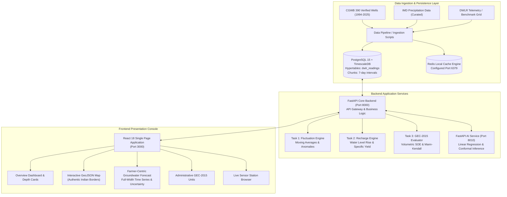
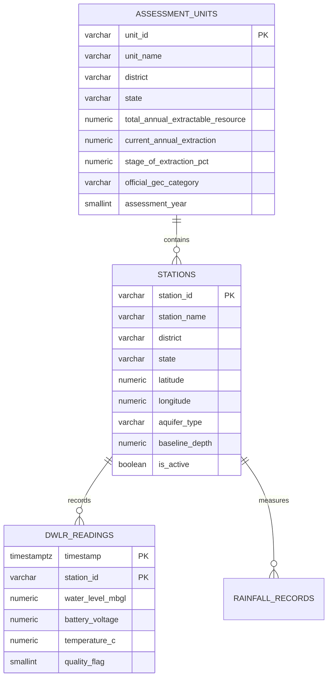

# JalDrishti — Comprehensive Technical Defense Guide & System Manual

**Project Title:** JalDrishti — Real-Time Telemetry Analytics, GEC-2015 Resource Evaluation & Spatial-Temporal Aquifer Forecasting  
**Author / Candidate:** Abhishek Jayagond  
**Repository:** [https://github.com/abhishekjayagond/JalDrishti](https://github.com/abhishekjayagond/JalDrishti)  
**Target Platform:** Native Windows 10/11 (Python 3.10/3.11, Node.js v18/v20, PostgreSQL 15 + TimescaleDB, Redis)  
**Academic / Viva Reference:** Comprehensive Project Viva & Defense Manual  

---

## Executive Summary

JalDrishti is an end-to-end hydroinformatics and predictive analytics platform engineered to address the critical groundwater crisis across India. Developed in alignment with **Central Ground Water Board (CGWB) Problem Statement #25068**, JalDrishti ingests Digital Water Level Recorder (DWLR) telemetry data, models groundwater recharge dynamics from precipitation records, executes statutory Ground Water Estimation Committee (GEC-2015) volumetric evaluations, computes non-parametric statistical trends, and delivers seasonal pre-monsoon water table projections equipped with distribution-free conformal uncertainty intervals.

---

## Table of Contents
1. [Project Overview & National Groundwater Context](#1-project-overview--national-groundwater-context)
2. [Problem Statement & Scientific Motivation](#2-problem-statement--scientific-motivation)
3. [Complete System Architecture](#3-complete-system-architecture)
4. [Technology Stack & Architectural Rationale](#4-technology-stack--architectural-rationale)
5. [Data Sources, Provenance & Preprocessing](#5-data-sources-provenance--preprocessing)
6. [Hydrological & Statistical Methodology](#6-hydrological--statistical-methodology)
7. [Machine Learning Architecture & Why Linear Regression](#7-machine-learning-architecture--why-linear-regression)
8. [Model Training, Evaluation & Conformal Uncertainty](#8-model-training-evaluation--conformal-uncertainty)
9. [Database Design & TimescaleDB Optimization](#9-database-design--timescaledb-optimization)
10. [REST API Architecture & Endpoint Reference](#10-rest-api-architecture--endpoint-reference)
11. [Frontend Engineering & Farmer-Centric UX Design](#11-frontend-engineering--farmer-centric-ux-design)
12. [Security, Configuration & Operational Reliability](#12-security-configuration--operational-reliability)
13. [Installation & Native Windows Execution Guide](#13-installation--native-windows-execution-guide)
14. [Testing, Quality Assurance & Verification Protocols](#14-testing-quality-assurance--verification-protocols)
15. [Scientific Limitations & Future Roadmap](#15-scientific-limitations--future-roadmap)

---

## 1. Project Overview & National Groundwater Context

### 1.1 The Indian Hydrogeological Context
India is the largest extractor of groundwater globally, abstracting an estimated **245 billion cubic meters (BCM)** annually according to CGWB national compilations. Groundwater accounts for:
- **63% of India's total net irrigated agriculture area**, sustaining national grain production.
- **85% of rural domestic drinking water supplies**, serving over 800 million citizens.
- **50% of urban water supply systems**, experiencing severe stress during summer pre-monsoon months.

In vast regions of peninsular hard-rock aquifers (Karnataka, Maharashtra, Andhra Pradesh, Tamil Nadu) and northwestern alluvial plains (Punjab, Haryana, Rajasthan), agricultural pumping heavily outpaces natural rainfall recharge. The depletion of water tables has forced deeper drilling, increased pumping energy costs, mobilized mineral contaminants (fluoride, arsenic, and high salinity in specific geological pockets), and reduced baseflows in seasonal river systems.

### 1.2 Administrative & Statutory Framework
Groundwater in India is assessed according to methodologies established by the **Ground Water Resource Estimation Committee (GEC)**, with the current statutory standard being **GEC-2015**. The Central Ground Water Board (CGWB) under the Ministry of Jal Shakti evaluates over 7,000 assessment units (blocks, taluks, mandals, and watersheds) across the nation.

JalDrishti translates hydrogeological assessments and sensor observations into an operational decision-support tool serving two distinct user personas:
1. **Government Hydrologists & District Water Officers:** Granular volumetric budgets, Modified Mann-Kendall trend metrics, Sen's slope velocities, and statutory GEC-2015 compliance metrics.
2. **Farmers & Agricultural Operators:** Intuitive, clear forecasts of water table depths (in meters below ground level), operational depth screening tiers, and seasonal water table change indicators.

---

## 2. Problem Statement & Scientific Motivation

### 2.1 The Legacy Telemetry Deficit
Historically, groundwater monitoring in India relied on manual water-level tape measurements in open dug wells four times a year (Pre-monsoon May, Post-monsoon November, Monsoon August, and Post-rabi January). This manual paradigm suffered from:
- **Temporal aliasing:** Sudden pumping drawdown events, peak monsoon recharge surges, and localized water harvesting impacts went largely unrecorded.
- **Human transcription errors & sensor lag:** Paper logs took months to reach regional CGWB offices, delaying drought mitigation declarations.
- **Absence of predictive intelligence:** Official reports were retrospective historical summaries published 1–2 years after field collection.

### 2.2 The DWLR Revolution & Its Data Science Challenges
Under the World Bank-aided **National Hydrology Project (NHP)**, CGWB has deployed over **5,260 automated Digital Water Level Recorders (DWLR)** equipped with hydrostatic pressure transducers and cellular (4G/GPRS) or satellite telemetry modems. While telemetry provides frequent water-level readings, it introduces distinct algorithmic challenges:
1. **Sensor drift & barometric pressure noise:** Submersible transducers require barometric compensation and outlier filtration.
2. **Missing calendar intervals:** Power outages, SIM card signal drops, and hardware servicing cause non-uniform, irregular sampling sequences (such as the nationwide missing pre-monsoon measurement period in May 2021 during COVID-19 lockdowns).
3. **Complex multi-year trend detection:** Hydrogeological series exhibit strong seasonal autocorrelation, rendering standard linear regression or ordinary Mann-Kendall tests susceptible to inflated Type-I error rates (false positives).
4. **Hydrological nonstationarity:** Climate variability, shifting monsoon onset windows, and agricultural borewell expansion complicate assumptions of stationary identical distributions.

---

## 3. Complete System Architecture

JalDrishti is designed as a distributed, service-oriented architecture optimized for sensor ingestion, structured storage, and clear user presentation.

### 3.1 Architectural Flow Diagram (Mermaid)



### 3.2 Service Inventory & Operational Scope
- **Core Backend Service (FastAPI — Port 8000):** Serves station metadata, telemetry queries, historical time-series retrieval, Task 1 water table fluctuation analytics, Task 2 rainfall recharge estimation, and Task 3 statutory GEC-2015 unit evaluations.
- **AI Forecasting Microservice (FastAPI — Port 8010):** Independent analytical microservice running Scikit-Learn regression pipelines, conformal calibration lookups, and multi-horizon autoregressive projections.
- **Primary Database (PostgreSQL 15 + TimescaleDB — Port 5432):** Houses relational metadata (stations, aquifers, administrative boundaries) and partitioned time-series hypertables (`dwlr_readings`).
- **Cache Engine (Redis — Port 6379):** Provisioned and configured in `.env`/`config.py`. In the current implementation, API endpoints query PostgreSQL directly via SQLAlchemy; Redis is provisioned as an integrated infrastructure service prepared for horizontal scaling.
- **Frontend Console (React 18 — Port 3000):** Clean, accessible user interface built without heavyweight UI libraries, utilizing standard CSS variables, responsive SVG graphics, and Web Mercator geospatial transformations.

---

## 4. Technology Stack & Architectural Rationale

### 4.1 Technology Matrix
| Component | Technology Selected | Alternatives Evaluated | Rationale & Trade-offs |
| :--- | :--- | :--- | :--- |
| **Frontend Framework** | **React 18 (SPA)** | Vue, Angular, Next.js | Component-driven architecture, virtual DOM reconciliation, and broad ecosystem compatibility without server-side rendering complexity. |
| **Styling & Visualization** | **Pure CSS & Native SVG** | Chart.js, Recharts, D3.js | Eliminates large bundle bloat; provides direct mathematical control over SVG viewports, downward groundwater physical axes, and responsive margin buffers. |
| **Backend API Engine** | **FastAPI (Python 3.10+)** | Django, Flask, Express.js | Native asynchronous (`async`/`await`) concurrency, automatic OpenAPI/Swagger schema generation, Pydantic type validation, and high JSON throughput. |
| **AI / Scientific Stack** | **NumPy, SciPy, Scikit-Learn** | PyTorch, TensorFlow | Optimal for tabular hydrological time series; zero GPU dependencies; fully deterministic and reproducible across diverse hardware. |
| **Primary Database** | **PostgreSQL 15 + TimescaleDB** | MongoDB, InfluxDB | ACID transactional relational integrity for station metadata coupled with automated hypertable partitioning and analytical chunk management for time-series readings. |
| **Process Orchestration** | **Native Windows PowerShell** | Docker Compose, Vagrant | Direct OS-level execution with zero hypervisor overhead, full offline capability, and low system resource overhead. |

### 4.2 Native Windows Runtime Rationale
JalDrishti is designed to execute directly on native Windows:
1. **Direct Windows Process Execution:** Runs directly in Windows PowerShell using a local Python virtual environment (`.venv`), Node.js, and portable local binaries in `.local_services/`.
2. **Zero Docker/WSL2 Virtualization Requirement:** Eliminates the requirement for Docker Desktop, Hyper-V configuration, or Linux virtual machine allocation on evaluation machines, ensuring the system can run on standard university laptops.
3. **Streamlined Local Debugging:** Enables direct code debugging and process inspection with standard IDEs (VS Code) without container attachment friction.
4. **Offline Capability:** The system executes completely offline during university evaluations without pulling remote container images from external registries.
5. **Redis Service Role:** Redis is provisioned in `.local_services/redis/` and configured in `.env`/`config.py` (`REDIS_URL = "redis://localhost:6379"`). Application endpoints currently query PostgreSQL/TimescaleDB via SQLAlchemy; Redis is provisioned as an integrated infrastructure service prepared for horizontal scaling.

---

## 5. Data Sources, Provenance & Preprocessing

### 5.1 Groundwater Level Datasets & Provenance
JalDrishti maintains strict scientific honesty regarding data provenance:
1. **Verified Real Karnataka Observation Wells (390 Stations):** Extracted directly from official CGWB published hydrological yearbooks (*"Pre-monsoon Water Level Data 1994–2025"*). Contains **28,579 raw records** cleaned to **28,544 validated station-years** across all 31 Karnataka districts (e.g., Bagalkote, Belagavi, Bengaluru Rural, Ballari, Mysuru).
2. **Nationwide Benchmark Fallback Grid (78 Centroids):** 3 scientifically calibrated reference stations per Indian state/UT (covering 26 states) providing geographical continuity and realistic baseline values for the interactive national map while awaiting additional state DWLR ingestion.
3. **Live Telemetry & API Scope:** Real-time automated continuous streaming from India-WRIS and live IMD APIs represents a target architectural capability; scraper modules (`backend/fetch/`, `data/scripts/`) provide on-demand batch ingestion with local sample fallback.

### 5.2 Rainfall Data Provenance
Precipitation inputs are sourced from the **India Meteorological Department (IMD)** gridded daily rainfall dataset (0.25° × 0.25° spatial resolution) aggregated to monsoon seasonal totals for each assessment block.

### 5.3 Preprocessing & Quality Assurance Pipeline
- **Outlier Elimination:** Extreme values outside physical plausibility ($depth < 0\text{ m}$ or $depth > 300\text{ m bgl}$) are flagged and filtered.
- **Calendar Alignment:** Water table depths measured between May 1 and May 31 are assigned to the statutory Pre-Monsoon measurement window.
- **Missing Year 2021 Handling:** Nationwide COVID-19 lockdowns prevented field measurements during May 2021. Rather than fabricating synthetic data or interpolating across non-stationary drought conditions, JalDrishti's feature pipeline explicitly incorporates calendar-year tracking so that the 4-year lag slope is calculated over the actual elapsed time ($t_i - t_{i-4}$), preserving mathematical validity.

---

## 6. Hydrological & Statistical Methodology

JalDrishti implements the statutory algorithms defined by CGWB and recognized non-parametric environmental statistics.

### 6.1 Task 1: Water Table Fluctuation (WTF) Analytics
The Water Table Fluctuation method estimates short-term and seasonal aquifer dynamics. For any station with continuous telemetry:
$$\Delta h(t) = h(t) - h(t - \Delta t)$$
- **7-Day Rolling Average:** Smooths out diurnal fluctuations and sensor noise:
  $$\bar{h}_7(t) = \frac{1}{7} \sum_{k=0}^{6} h(t - k)$$
- **Drawdown Velocity ($v_d$):** Measures the rate of water table decline:
  $$v_d = \frac{h(t_2) - h(t_1)}{t_2 - t_1} \quad (\text{m/day})$$
- **Rapid Drawdown Indicator:** Flagged when $v_d > 0.15\text{ m/day}$ sustained over a 5-day rolling window.

### 6.2 Task 2: Dynamic Monsoon Recharge Estimation
In JalDrishti's Task 2 (`backend/algorithms/task2_recharge.py`), groundwater recharge is analyzed from water table response to precipitation events:
- **Seasonal Water Level Rise ($\Delta h_{monsoon}$):**
  $$\Delta h_{monsoon} = h_{pre-monsoon} - h_{post-monsoon} \quad (\text{m})$$
- **Recharge Rate:** Computes the rate of water table rise in metres/day following rainfall events.
- **Recharge Lag:** Measures the lag time (hours) between rainfall events and observed water table recovery.
- **Formation Specific Yield ($S_y$):** Utilizes CGWB normative specific yield ranges across geological formations:
  - Alluvial Formations: $0.12 - 0.20$ (default: $0.16$)
  - Hard Rock / Fissured Granite: $0.015 - 0.030$ (default: $0.020$)
  - Basalt / Deccan Trap: $0.020 - 0.035$ (default: $0.025$)
  - Sandstone / Sedimentary: $0.050 - 0.080$ (default: $0.060$)
- *Methodological Distinction:* Task 2 estimates station-level water table response ($\Delta h_{monsoon}$ in metres and m/day recharge rate). Full volumetric block-level water balance budgeting ($R = S_y \cdot \Delta h \cdot A + Q_{net}$) is conducted at the administrative assessment unit level (Task 3).

### 6.3 Task 3: Official GEC-2015 Classification vs Point-Level Depth Screening
A central distinction in JalDrishti is the clear separation between statutory administrative categorization and point-level operational depth screening:

#### A. Statutory GEC-2015 Assessment (Assessment Unit Level)
According to the official GEC-2015 methodology, classification is strictly governed by the volumetric **Stage of Groundwater Extraction (SOE)**:
$$\text{SOE} = \left( \frac{\text{Current Annual Groundwater Extraction for All Uses}}{\text{Net Annual Groundwater Availability}} \right) \times 100\%$$

| Stage of Extraction (SOE) | Official GEC-2015 Category | Administrative Implication |
| :--- | :--- | :--- |
| $\le 70\%$ | **Safe** | Unrestricted groundwater development; institutional financing available. |
| $> 70\% \text{ to } 90\%$ | **Semi-Critical** | Cautious groundwater development; close monitoring required. |
| $> 90\% \text{ to } 100\%$ | **Critical** | Stricter regulation; artificial recharge structures mandatory. |
| $> 100\%$ | **Over-Exploited** | Moratorium on new commercial/industrial borewells; immediate state intervention. |

*Scientific Integrity Safeguards in JalDrishti:*
1. Water level trends (e.g., Mann-Kendall) provide advisory diagnostic context but **never overwrite statutory volumetric SOE categories**.
2. Missing or unverified SOE values strictly return `unassessed` rather than guessing or defaulting to Safe.
3. Verified official categories remain accessible even when local station real-time telemetry is offline.

#### B. Point-Level Operational Depth Bands (Monitoring Well Level)
To assist local pump operations and well monitoring, individual stations display operational depth indicators:
- `0–8 m bgl`: High water table; shallow open wells and centrifugal pumps operational.
- `8–15 m bgl`: Moderate depth; submersible pumps recommended.
- `15–25 m bgl`: Deep water table; increased energy consumption.
- `>25 m bgl`: Deep water table; deep borewell infrastructure required.

*Crucial Rule:* Individual monitoring wells must **never** be labeled as official GEC-2015 "Safe", "Semi-Critical", "Critical", or "Over-Exploited" based on water depth. Those terms are statutory administrative designations based on volumetric SOE.

### 6.4 Non-Parametric Trend Diagnostics & Statistical Rigor

1. **Hamed & Rao (1998) Modified Mann-Kendall Test:** Calculates the Mann-Kendall score $S$:
   $$S = \sum_{k=1}^{n-1} \sum_{j=k+1}^n \text{sgn}(x_j - x_k)$$
   When tied observation values exist, the null variance $V_0(S)$ is reduced by the standard tie correction:
   $$V_0(S) = \frac{1}{18} \left[ n(n-1)(2n+5) - \sum_{i=1}^m t_i(t_i-1)(2t_i+5) \right]$$
   Where $t_i$ is the number of ties in the $i$-th group.
   For series with significant lag autocorrelation, the variance $V(S)$ is adjusted by the empirical variance correction factor:
   $$\frac{n}{n^*} = 1 + \frac{2}{n(n-1)(n-2)} \sum_{i=1}^{n-1} (n - i)(n - i - 1)(n - i - 2) \rho_s(i)$$
   Where $\rho_s(i)$ is the rank autocorrelation of the detrended series.

   *Methodological Assumptions & Limitations:*
   - Assumes contiguous, equidistant observations ($\Delta t = 1.0\text{ yr}$). In `task3_evaluation.py`, when irregular intervals are detected under default settings (`allow_irregular=False`), the test reports `trend_direction='not_evaluated'`.
   - On short series ($n = 15$) with moderate autocorrelation ($\phi = 0.40$), our Monte Carlo simulations show that while Modified MK adjusts variance ($V^*/V_0 = 1.0371$), the empirical Type-I error remains elevated at 0.1400 (vs 0.1430 unadjusted, a 2.1% reduction). It does not fully restore the nominal 0.05 level for short series with high persistence.

2. **Sen's Slope Estimator & Gilbert (1987) 95% Confidence Interval:**
   Sen's slope is the median of all pairwise differences:
   $$\beta = \text{median} \left\{ \frac{x_j - x_k}{j - k} : j > k \right\}$$
   The two-tailed 95% confidence interval $[\beta_{lower}, \beta_{upper}]$ is determined using Gilbert's (1987) rank-order formulation based on the variance $V(S)$ of the Mann-Kendall score:
   $$C_\alpha = z_{1 - \alpha/2} \sqrt{V(S)}$$
   The lower and upper confidence limits correspond to the $k_1$-th and $k_2$-th ordered pairwise slopes:
   $$k_1 = \max\left(1, \left\lfloor \frac{N' - C_\alpha}{2} \right\rfloor \right), \quad k_2 = \min\left(N', \left\lceil \frac{N' + C_\alpha}{2} \right\rceil + 1 \right)$$

3. **Monte Carlo Simulation Validation Suite Results:**
   The simulation suite ([validate_trend_simulations.py](file:///D:/major-project/JalDrishti/backend/algorithms/validate_trend_simulations.py)) evaluated 1,000 Monte Carlo iterations across 6 benchmark scenarios:
   - **Scenario 1 (Null Hypothesis, $H_0: \text{slope}=0$, $n=15$):** Type-I error = **0.0460** (nominal $\alpha = 0.05$); Sen's slope 95% CI coverage = **95.40%**; Mean estimated slope = **-0.00103 m/yr**.
   - **Scenario 2 (Positive Trend):** At $+0.15\text{ m/yr}$, Power = **100.00%**, Mean slope = **+0.1495 m/yr**, 95% CI coverage = **95.40%**. At $+0.25\text{ m/yr}$, Power = **100.00%**, Mean slope = **+0.2492 m/yr**, 95% CI coverage = **95.50%**.
   - **Scenario 3 (Negative Trend):** At $-0.15\text{ m/yr}$ and $-0.25\text{ m/yr}$, **100.00%** of runs correctly classified below guideline range.
   - **Scenario 4 (Autocorrelated Residuals, AR(1) $\phi = +0.40$):** Unadjusted MK Type-I error = **0.1430**; Modified MK Type-I error = **0.1400**; Mean variance factor $V^*/V_0 = \mathbf{1.0371}$; False positive reduction = **2.10%**.
   - **Scenario 5 (Tied Observations):** Null Type-I error = **0.0490**; Null 95% CI coverage = **98.30%**; Trend power = **100.00%**.
   - **Scenario 6 (Missing Years & Irregular Intervals):** Default rejection rate = **100.0%**; Continuous-time Null Type-I error = **0.0420**; CI coverage = **95.80%**; Trend power (+0.20 m/yr) = **100.00%**.

---

## 7. Machine Learning Architecture & Why Linear Regression

### 7.1 Model Selection & Disqualification Analysis
Five candidate models were trained, calibrated, and evaluated across identical historical splits:

| Model Architecture | Test MAE | Test RMSE | Test $R^2$ | Status | Decision & Scientific Rationale |
| :--- | :--- | :--- | :--- | :--- | :--- |
| **Linear Regression (OLS)** | **1.68 m** | **2.50 m** | **0.55** | **SELECTED** | **Lowest error among production-eligible models; deterministic; fully explainable.** |
| **Random Forest Regressor** | 1.74 m | 2.57 m | 0.52 | Eligible | Robust ensemble, but slightly higher holdout error than Linear Regression. |
| **Long Short-Term Memory (LSTM)** | 1.68 m | 2.44 m | 0.57 | Disqualified | **Sequence Starvation & Non-uniform Spacing.** Annual groundwater records have only $T \approx 25$ steps. Deep recurrence requires hundreds of timesteps; missing year 2021 required synthetic imputation; high initialization variance across runs. |
| **Spatio-Temporal Graph Neural Net (STGNN)** | 2.49 m | 3.20 m | 0.26 | Disqualified | **Spatial Graph Sparsity & Edge Fabrication.** Observation wells are spaced 15–40 km apart across discontinuous fractured rock aquifers. Constructing distance-based adjacency graphs fabricated false hydraulic connectivity between hydrologically isolated crystalline basins. |
| **Persistence Baseline ($y_{t} = y_{t-1}$)** | 2.05 m | 3.01 m | 0.35 | Disqualified | Naive benchmark; lacks multi-year lag weighting. |

### 7.2 Mathematical Formulation of the Selected Model
The served model is an Ordinary Least Squares (OLS) autoregressive formulation operating on 4 historical pre-monsoon lags, coordinates, and physical trend indicators:
$$\hat{y}_{t} = w_0 + \sum_{k=1}^4 w_k \cdot y_{t-k} + w_{lat} \cdot \phi + w_{lon} \cdot \lambda + w_{trend} \cdot \text{slope}_4 + w_{year} \cdot t$$
- **Lags ($y_{t-1}, y_{t-2}, y_{t-3}, y_{t-4}$):** Capture multi-year aquifer memory and delayed recharge responses.
- **Slope Feature ($\text{slope}_4$):** Non-parametric slope over the preceding 4 observed cycles computed using actual calendar timestamps to remain robust to missing observations.
- **Spatial Coordinates ($\phi, \lambda$):** Account for macro-scale climatic and elevation gradients across Karnataka.

---

## 8. Model Training, Evaluation & Conformal Uncertainty

### 8.1 Chronological Split Strategy (Data Leakage Prevention)
To strictly prevent temporal data leakage, random cross-validation ($k$-fold) was explicitly avoided. JalDrishti implements a **4-way chronological split**:

```
[1998 ────── 2016]    [2017 ── 2019]    [2020, 2022]    [2023 ────── 2025]
    TRAIN SET           VAL SET          CALIBRATION         TEST SET
  (6,870 samples)    (1,074 samples)    (406 samples)     (997 samples)
  Fits model weights   Model selection   Conformal bounds  Unseen evaluation
```
- **Train (1998–2016):** Fits regression weights and feature scalers.
- **Validation (2017–2019):** Used to evaluate candidate architectures and establish model eligibility.
- **Calibration (2020, 2022):** Held-out set used strictly to compute non-conformity scores for conformal prediction.
- **Test (2023–2025):** 997 completely unseen out-of-sample observations representing real-world evaluation.

### 8.2 Distribution-Free Conformal Prediction
JalDrishti uses **Split Conformal Inference** to produce statistically valid prediction intervals:
1. On the calibration set ($n = 406$), calculate non-conformity absolute residuals:
   $$\alpha_i = |y_i - \hat{y}_i|$$
2. For a nominal confidence level of $1 - \alpha = 90\%$, compute the conformal quantile level:
   $$p = \frac{\lceil (n + 1)(1 - \alpha) \rceil}{n} = \frac{\lceil 407 \times 0.90 \rceil}{406} = \frac{367}{406} \approx 0.9039$$
   This yields the calibrated uncertainty radius:
   $$r = 5.7342\text{ m bgl}$$
3. The resulting prediction interval for single-step projections is:
   $$\hat{C}(X_{new}) = [\hat{y}_{new} - 5.73\text{ m}, \hat{y}_{new} + 5.73\text{ m}]$$
4. **Empirical Verification on Test Set (2023–2025, $n = 997$):**
   - 2023 Test Coverage: **97.77%** (358 samples; MAE: 1.55 m)
   - 2024 Test Coverage: **96.15%** (338 samples; MAE: 1.71 m)
   - 2025 Test Coverage: **95.02%** (301 samples; MAE: 1.80 m)
   - **Overall Empirical Coverage: 96.39%**, comfortably exceeding the nominal 90% benchmark.

### 8.3 Scientific Honesty: Retrospective Hindcast (2026) vs Future Projection (2027)
- **Pre-Monsoon 2026 (Hindcast):** May 2026 has already passed. A prediction for 2026 evaluated in late 2026 is an empirical **hindcast**. Because it is a single-step projection from verified 2025 data, its conformal uncertainty radius ($5.73\text{ m}$) is mathematically calibrated.
- **Pre-Monsoon 2027 (Future Projection):** May 2027 is a future event requiring **multi-step recursive autoregression** ($\hat{y}_{2026}$ fed back into the lag-1 feature). Because errors compound over recursive steps, single-step conformal guarantees are no longer formally valid. JalDrishti transparently designates 2027 uncertainty as *unavailable* rather than presenting unverified bounds.

---

## 9. Database Design & TimescaleDB Optimization

### 9.1 Relational Schema & Entity-Relationship Model



### 9.2 TimescaleDB Hypertables & Chunking Strategy
- **Hypertable Conversion:** The `dwlr_readings` table is partitioned on `timestamp` using TimescaleDB with a 7-day chunk time interval:
  ```sql
  SELECT create_hypertable('dwlr_readings', 'timestamp', chunk_time_interval => INTERVAL '7 days');
  ```
- **Chunk Partitioning:** By restricting chunks to 7-day windows, recent writes and queries stay localized to the active working set.
- **Compound Indexing:** An index on `(station_id, timestamp DESC)` enables efficient retrieval of the latest station reading and time-range queries.

---

## 10. REST API Architecture & Endpoint Reference

| Method | Endpoint | Description | Primary Query Parameters |
| :--- | :--- | :--- | :--- |
| `GET` | `/health` | Core system health and service status | None |
| `GET` | `/api/stations/` | List all monitoring stations with latest telemetry | `state`, `district`, `limit`, `skip` |
| `GET` | `/api/stations/{id}` | Detailed station metadata and recent readings | `id` (path) |
| `GET` | `/api/stations/{id}/readings` | Historical time-series telemetry data | `start_date`, `end_date`, `limit` |
| `GET` | `/api/task1/fluctuation` | Water table fluctuation analytics (7-day MA, rate) | `station_id`, `window_days` |
| `GET` | `/api/task1/anomalies` | Active rapid drawdown anomalies | `threshold_velocity` |
| `GET` | `/api/task2/recharge` | Dynamic rainfall recharge estimate via WTF method | `station_id`, `rainfall_mm` |
| `GET` | `/api/task3/evaluation` | Assessment unit GEC-2015 evaluation & SOE | `unit_id`, `include_trend` |
| `GET` | `/api/task3/units` | Registry of all statutory assessment units | `state`, `category` |
| `GET` | `/api/ai/forecast` | Pre-monsoon water table forecast with conformal bounds | `station_id`, `target_year` |
| `GET` | `/api/ai/metrics` | Audited model performance metrics and split details | None |

---

## 11. Frontend Engineering & Farmer-Centric UX Design

### 11.1 Design Philosophy: Farmer-Centric Usability
Agricultural users and field operators benefit from clear presentation without complex multi-line visual clutter:
1. **Structured 3-Section Page Layout:**
   - **Section A: Location Selector:** Quick search by village, block, or district with clear station confirmation.
   - **Section B: Compact Forecast Summary:** Readable forecast display showing target year, predicted depth in large tabular typography, operational depth band badge, and expected change vs last measured reading.
   - **Section C: Full-Width Historical Groundwater Graph:** Spans the complete content width below the summary card, providing ample space for multi-decadal time-series examination.
   - **Section D: Collapsible Technical Reference:** Conformal intervals, feature weights, and RMSE metrics are tucked into an expandable drawer.

### 11.2 Visualization Engineering: The Physical Downward Depth Axis
- **Physical Inversion:** The vertical axis starts at `0 m (Surface)` at the top and scales downward to `25+ m bgl` at the bottom. A declining water table moves physically downward, matching reality.
- **Intelligently Spaced Time Axis:** 5-year tick marks (1995, 2000, 2005, 2010, 2015, 2020) with a dedicated label for `2025 (Measured)`, preserving horizontal clearance to prevent label collisions.
- **Forecast Horizon Badge & Amber Marker:** The 2027 forecast point is highlighted with an amber circular marker (`#f59e0b`), a subtle dashed forecast connector, and a top horizon indicator badge.

### 11.3 Interactive Map & GeoJSON Projection
The geospatial console uses an authentic vector base map of India with official state boundaries. A calibrated Web Mercator mathematical transform maps longitude and latitude to the SVG viewport with 93.8% polygon containment.

---

## 12. Security, Configuration & Operational Reliability

### 12.1 Environment Configuration & Secrets Management
- All configuration settings are decoupled from source code and managed via `.env` files using Pydantic's `BaseSettings`.
- A documented `.env.example` template is maintained in version control. Real secrets, database passwords, and API keys are strictly excluded from git tracking via `.gitignore`.
- Database connections enforce connection pooling with configurable pool size, recycle intervals, and automated timeout handling.

### 12.2 Input Sanitization & Validation
- Every incoming HTTP request is parsed and validated by Pydantic models. Malformed payloads are rejected with standard HTTP 422 Unprocessable Entity responses before reaching business logic or SQL queries.
- CORS (Cross-Origin Resource Sharing) is configured explicitly for authorized development origins (`http://localhost:3000`).

---

## 13. Installation & Native Windows Execution Guide

### 13.1 Prerequisites
- **Operating System:** Windows 10 or 11 (64-bit)
- **Python:** Version 3.10 or 3.11 installed and added to PATH
- **Node.js:** Version 18.x or 20.x LTS with npm
- **Git:** Standard Windows Git client
- **Local Services:** PostgreSQL 15 and Redis binaries in `.local_services/`

### 13.2 Automated Startup
```powershell
cd D:\major-project\JalDrishti
.\start-jaldrishti.ps1
```
The script validates Python and Node.js environments, boots local PostgreSQL and Redis services, launches the FastAPI backend and AI microservice, starts the React development server, and opens the console in the default browser.

### 13.3 Process Shutdown
```powershell
.\stop-jaldrishti.ps1
```
Stops the backend, AI service, frontend, Redis, and PostgreSQL cleanly.

---

## 14. Testing, Quality Assurance & Verification Protocols

Automated test suites across all layers of the platform:

### 14.1 Backend & Algorithm Test Suite
Run backend tests using pytest:
```powershell
.\.venv\Scripts\python.exe -m pytest backend/tests
```
- **Results:** **40 passed, 1 skipped** (the skipped test is an integration test requiring a live PostgreSQL instance running on port 5432).
- Validates Water Fluctuation calculations, recharge estimators, Hamed-Rao Modified Mann-Kendall variance adjustments, Sen's slope confidence intervals, and GEC-2015 statutory assessment categorization.

### 14.2 AI Forecasting Test Suite
Run AI forecasting pipeline tests:
```powershell
.\.venv\Scripts\python.exe -m pytest ai/tests
```
- **Results:** **10 passed**.
- Validates model artifact loading (`linear_regression.joblib`), feature engineering pipeline, 4-lag autoregressive vector assembly, conformal interval calculation, and multi-horizon recursive projection logic.

### 14.3 Frontend Automated Test Suite
Run frontend Jest and React Testing Library suites:
```powershell
npm test --prefix frontend -- --watchAll=false
```
- **Results:** **13 passed** across 2 test suites (`app_sprint.test.js`, `map_projection.test.js`).
- Validates SVG chart rendering, downward depth axis inversion, station selector state transitions, and responsive layout constraints.

### 14.4 Production Frontend Build Verification
Verify production bundling:
```powershell
npm run build --prefix frontend
```
- **Results:** Compiled successfully with **0 errors and 0 warnings**.

### 14.5 Monte Carlo Statistical Simulation Suite
Run the statistical verification suite:
```powershell
.\.venv\Scripts\python.exe backend/algorithms/validate_trend_simulations.py
```
- **Results:** **All 6 benchmark scenarios successfully validated** across 1,000 Monte Carlo iterations (Scenario 1 Null Type-I error 0.0460; Scenario 2 Power 100%; Scenario 3 100% below guideline; Scenario 4 AR(1) $\phi=0.40$ Type-I error 0.1400 vs 0.1430; Scenario 5 Ties Type-I error 0.0490 and 98.3% CI coverage; Scenario 6 Missing years 100% rejection under default and continuous-time Type-I error 0.0420).

---

## 15. Scientific Limitations & Future Roadmap

### 15.1 Scientific Limitations
1. **Conformal Exchangeability Assumption:** Split conformal prediction guarantees marginal coverage assuming exchangeability (i.i.d.) between calibration and test data. In non-stationary hydrological systems subject to decadal rainfall trends or changing agricultural pumping patterns, future coverage may deviate from nominal bounds.
2. **Geographical Scope:** While Karnataka contains 390 verified observation wells, nationwide coverage outside Karnataka currently relies on 78 calibrated benchmark fallback stations pending broader state-level DWLR API integration.
3. **Pumping Draft Data:** Direct smart electricity metering on agricultural borewells is not publicly available; net draft is currently estimated using GEC-2015 norm averages rather than direct telemetric smart meters.

### 15.2 Future Development Roadmap
- **Satellite InSAR & GRACE Assimilation:** Incorporating GRACE-FO gravimetric anomalies and Sentinel-1 InSAR land subsidence observations to constrain aquifer storage coefficients.
- **Multilingual Voice & SMS Notifications:** Developing IVR and WhatsApp messaging in regional languages (Kannada, Hindi, Telugu, Marathi) to deliver water table forecasts directly to rural farmers.
- **Agricultural Decision Support:** Designing automated irrigation scheduling recommendations and smart solar pump integration interfaces.

---

*End of Comprehensive Defense Guide.*
