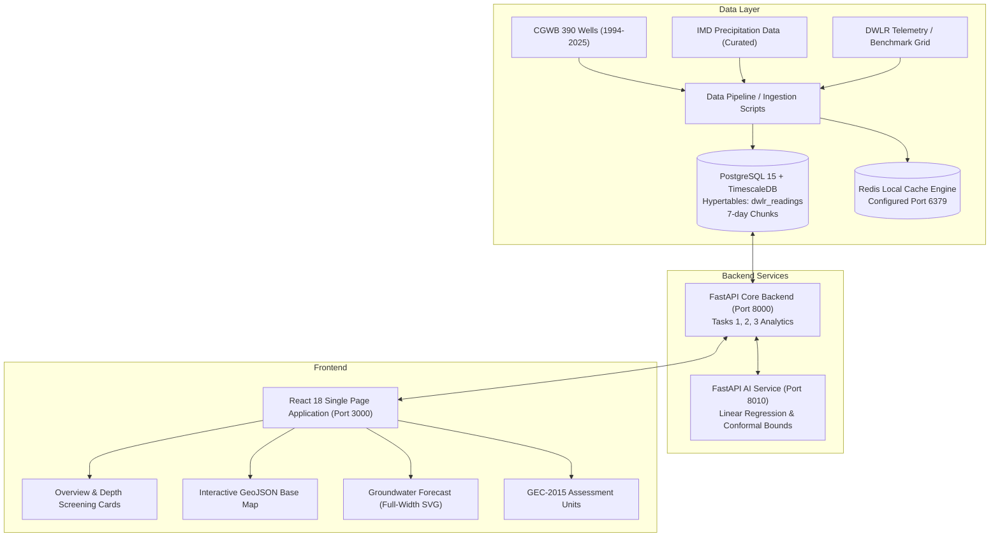

# JalDrishti

**Groundwater Telemetry Analytics, GEC-2015 Assessment, and Seasonal Aquifer Forecasting**  
*Central Ground Water Board (CGWB) Problem Statement #25068*

**Author:** Abhishek Jayagond  
**Repository:** https://github.com/abhishekjayagond/JalDrishti

---

## Overview

JalDrishti is a groundwater monitoring and forecasting platform built for Central Ground Water Board (CGWB) Problem Statement #25068. The system processes groundwater level observations from automated Digital Water Level Recorders (DWLR), evaluates aquifer extraction using statutory GEC-2015 guidelines, and forecasts future pre-monsoon water table depths using machine learning.

In India, groundwater accounts for roughly 63% of net irrigated agriculture and 85% of rural drinking water supplies. In many agricultural regions, pumping heavily outpaces seasonal monsoon recharge, causing steady water table depletion. Under the National Hydrology Project, the CGWB has deployed over 5,260 automated DWLR stations across the country. While this network provides regular water-level observations, turning raw sensor readings into practical guidance requires reliable data pipelines, statutory accounting, and interpretable forecasting models.

JalDrishti was built to address these challenges. It currently runs on a verified baseline of 390 long-term Karnataka CGWB observation wells (covering 32 years of pre-monsoon records from 1994 to 2025; 28,544 validated station-years) along with 78 nationwide benchmark stations across 26 states for interface continuity.

---

## What the System Does

JalDrishti organizes groundwater analytics into four core tasks:

### 1. Water Table Fluctuation Analytics (Task 1)
- Tracks groundwater depth observations over time and computes 7-day rolling averages to filter out daily pumping noise.
- Calculates drawdown velocity to detect rapid local water table decline ($v_d > 0.15\text{ m/day}$).
- Maps monitoring stations across India using an accurate vector-based base map with official state boundaries.

### 2. Dynamic Monsoon Recharge Estimation (Task 2)
- Evaluates how aquifers recover following rainfall events by comparing pre-monsoon and post-monsoon water levels.
- Computes seasonal water level recovery ($\Delta h_{monsoon} = h_{pre} - h_{post}$ in metres) and recovery rates across major geological formations (Alluvial, Hard Rock, Basalt, Granite, and Sandstone) using CGWB specific yield ($S_y$) values.
- Identifies stations with zero or negative seasonal recovery where natural recharge is failing to replenish the water table.
- *Note:* Task 2 calculates station-level water table responses. Full volumetric water balance budgeting at the block scale ($R = S_y \cdot \Delta h \cdot A + Q_{net}$) is handled under Task 3.

### 3. Aquifer Assessment & Statutory GEC-2015 Categorization (Task 3)
- **Official GEC-2015 Administrative Categorization:**
  Evaluates administrative blocks or taluks strictly using the volumetric Stage of Groundwater Extraction (SOE):
  $$\text{SOE (\%)} = \left( \frac{\text{Current Annual Groundwater Extraction for All Uses}}{\text{Net Annual Groundwater Availability}} \right) \times 100\%$$
  The official statutory categories are:
  - **Safe:** $\text{SOE} \le 70\%$
  - **Semi-Critical:** $70\% < \text{SOE} \le 90\%$
  - **Critical:** $90\% < \text{SOE} \le 100\%$
  - **Over-Exploited:** $\text{SOE} > 100\%$
- **Scientific Integrity Rule:** Water table trends provide advisory context on whether water levels are deepening or recovering, but they **never overwrite official statutory SOE categories**. If extraction data is missing or unverified, the system marks the unit as `unassessed` rather than assuming a category.
- **Operational Depth Screening Tiers:**
  Separate from administrative assessment, the interface displays physical depth intervals for individual monitoring wells to help with pump planning:
  - `0–8 m bgl`: High water table; surface and shallow centrifugal pumps work well.
  - `8–15 m bgl`: Moderate depth; submersible pumps recommended.
  - `15–25 m bgl`: Deep water table; increased pumping energy required.
  - `>25 m bgl`: Deep water table; deep borewell infrastructure required.
  *(These depth intervals are physical screening ranges for individual wells. They are never labeled as official GEC-2015 categories.)*
- **Statistical Trend Diagnostics:**
  - Hamed & Rao (1998) Modified Mann-Kendall test to account for autocorrelation in hydrological series.
  - Sen's slope estimator with Gilbert (1987) 95% confidence intervals and tied-rank adjustments.
  - Evaluation against the CGWB guideline threshold range ($0.10–0.20\text{ m/year}$).

### 4. Seasonal Machine Learning Forecasting (Task 4)
- Forecasts future pre-monsoon water table depths (in metres below ground level) for the upcoming May measurement window.
- Trained on 390 long-history Karnataka observation wells spanning 1994 to 2025.
- Uses a strict 4-way chronological split to prevent temporal data leakage:
  - **Training (1998–2016, 6,870 samples):** Fits model weights and scalers.
  - **Validation (2017–2019, 1,074 samples):** Used for candidate model evaluation and selection.
  - **Calibration (2020, 2022, 406 samples):** Used strictly to calibrate conformal uncertainty intervals.
  - **Test (2023–2025, 997 samples):** Clean future holdout evaluation.
- Evaluated against multiple candidates; Linear Regression was selected as the production model based on holdout performance:
  - Test RMSE: **2.50 m bgl**
  - Test MAE: **1.68 m bgl**
  - Test $R^2$: **0.55**
- **Conformal Prediction:** Uses split conformal inference to calculate a distribution-free uncertainty interval ($r = 5.73\text{ m bgl}$) at 90% confidence, achieving 96.39% empirical coverage across the 2023–2025 test set.
- **Forecast Horizons:** Pre-monsoon 2026 is evaluated as a single-step hindcast from 2025 data (with calibrated uncertainty). Pre-monsoon 2027 is a multi-step recursive projection; uncertainty is designated as unavailable to avoid false statistical precision.

---

## Why Linear Regression?

During development, five model architectures were evaluated on identical historical splits. A common question is why a linear model was chosen over deep learning methods like LSTM or Spatio-Temporal Graph Neural Networks (STGNN).

Evaluation on the 997-sample unseen test holdout (2023–2025):

| Model | Test MAE (m) | Test RMSE (m) | Test $R^2$ | Status | Practical Rationale |
| :--- | :---: | :---: | :---: | :---: | :--- |
| **Linear Regression (OLS)** | **1.68** | **2.50** | **0.55** | **Selected** | **Lowest holdout error among eligible models; deterministic; transparent feature weights.** |
| **Random Forest Regressor** | 1.74 | 2.57 | 0.52 | Eligible | Good baseline, but slightly higher holdout error; cannot extrapolate continuous deepening trends. |
| **LSTM (Deep Recurrent)** | 1.68 | 2.44 | 0.57 | Disqualified | Annual series have only ~25 steps (sequence starvation); missing year 2021 required artificial imputation; high parameter initialization variance. |
| **STGNN (Graph Neural Net)** | 2.49 | 3.20 | 0.26 | Disqualified | Wells are 15–40 km apart across fractured bedrock; distance-based graph edges fabricated connections across impermeable barriers; spatial over-smoothing. |
| **Persistence Baseline ($y_t = y_{t-1}$)** | 2.05 | 3.01 | 0.35 | Disqualified | Simple benchmark to verify that learned models outperform a naive copy of the last reading. |

The served Linear Regression model uses 4 historical lags ($y_{t-1}$ to $y_{t-4}$), coordinates, a 4-year non-parametric slope calculated with actual calendar years (handling the missing 2021 measurement naturally), and target year. It matches or outperforms complex alternatives on unseen data while running in less than 1 ms and offering full physical explainability.

---

## System Architecture



---

## Technology Stack

- **Frontend:** React 18 with custom semantic HTML, CSS modules, and custom SVG charts. (Using native SVG allowed inverting the depth axis so deeper water levels physically move downwards, matching real-world intuition.)
- **Backend APIs:** Python 3.10+, FastAPI, Uvicorn, SQLAlchemy ORM, and Pydantic validation.
- **Database:** PostgreSQL 15 with TimescaleDB time-series extension (partitioned into 7-day chunks for efficient telemetry queries).
- **Cache Service:** Redis (configured via `REDIS_URL`, provisioned for scaling).
- **Machine Learning:** Scikit-Learn, NumPy, SciPy, Joblib.
- **Process Orchestration:** PowerShell launch scripts (`start-jaldrishti.ps1`, `stop-jaldrishti.ps1`).

---

## Quick Start (Windows)

### Prerequisites
- Windows 10 or 11 (64-bit)
- Python 3.10 or 3.11 installed and added to PATH
- Node.js 18.x or 20.x LTS with npm
- Git for Windows
- Local PostgreSQL 15 and Redis binaries placed in `.local_services/`

### Starting the Application
Open a PowerShell terminal in the repository root and run:

```powershell
.\start-jaldrishti.ps1
```

This script:
1. Checks the Python virtual environment and Node.js runtime.
2. Starts local PostgreSQL (TimescaleDB) on port 5432.
3. Starts local Redis on port 6379.
4. Starts the FastAPI Core Backend on `http://localhost:8000`.
5. Starts the FastAPI AI Forecasting Service on `http://localhost:8010`.
6. Starts the React development server on `http://localhost:3000`.
7. Opens the web console in your default browser once services respond.

### Stopping the Application
To shut down all running background services:

```powershell
.\stop-jaldrishti.ps1
```

---

## Testing & Verification

The project includes automated tests for each layer of the application:

```powershell
# 1. Backend and hydrogeological algorithm tests
.\.venv\Scripts\python.exe -m pytest backend/tests

# 2. Machine learning and forecasting pipeline tests
.\.venv\Scripts\python.exe -m pytest ai/tests

# 3. Frontend component tests
npm test --prefix frontend -- --watchAll=false

# 4. Frontend production build verification
npm run build --prefix frontend

# 5. Monte Carlo statistical trend simulation validation (1,000 iterations across 6 scenarios)
.\.venv\Scripts\python.exe backend/algorithms/validate_trend_simulations.py
```

### Verified Test Results
- **Backend Tests:** 40 passed, 1 skipped (the skipped test is an integration test requiring a live PostgreSQL database running on port 5432).
- **AI Tests:** 10 passed.
- **Frontend Tests:** 13 passed across 2 suites (`app_sprint.test.js` and `map_projection.test.js`).
- **Production Build:** Compiled cleanly with 0 errors and 0 warnings.
- **Monte Carlo Simulations:** All 6 benchmark scenarios validated (Scenario 1 Null Type-I error: 0.0460; Scenario 2 Power: 100%; Scenario 3 Negative trend: 100% below guideline; Scenario 4 Autocorrelation: Type-I error 0.1400 vs 0.1430; Scenario 5 Tied ranks: 98.3% coverage; Scenario 6 Missing years: continuous-time Type-I error 0.0420).

---

## REST API Summary

| Endpoint | Method | Purpose |
| :--- | :---: | :--- |
| `/health` | `GET` | Health check and service status |
| `/api/stations/` | `GET` | Station list with optional state/district filters |
| `/api/stations/{id}` | `GET` | Station metadata and most recent readings |
| `/api/stations/{id}/readings` | `GET` | Historical water-level telemetry records |
| `/api/task1/fluctuation` | `GET` | Water table fluctuation metrics and 7-day moving average |
| `/api/task1/anomalies` | `GET` | Rapid drawdown detection alerts |
| `/api/task2/recharge` | `GET` | Rainfall recharge estimate using water level recovery |
| `/api/task3/evaluation` | `GET` | Official GEC-2015 assessment unit evaluation and SOE |
| `/api/task3/units` | `GET` | List of administrative assessment units and status |
| `/api/ai/forecast` | `GET` | Pre-monsoon water depth forecast with conformal interval |
| `/api/ai/metrics` | `GET` | Audited model evaluation metrics and split details |

---

## Data Provenance & Current Scope

- **Groundwater Records:** 390 verified observation wells in Karnataka extracted from official CGWB yearbooks (*"Pre-monsoon Water Level Data 1994–2025"*), providing 28,544 validated station-years. 78 national benchmark nodes provide geographic continuity across 26 states for testing the interface.
- **Precipitation Data:** Curated IMD gridded daily rainfall data ($0.25^\circ \times 0.25^\circ$) aggregated across monsoon seasons.
- **Current Integration Scope:** Ingestion scripts in `data/scripts/` and `backend/fetch/` provide batch ingestion prototypes with local sample fallbacks. Continuous live automated streaming from India-WRIS and live IMD APIs represents a target capability requiring official ministry network credentials.
- **Agricultural Features Scope:** The interface displays operational depth screening tiers (`0–8 m`, `8–15 m`, `15–25 m`, `>25 m`) and expected changes to assist local well awareness. Automated irrigation valve scheduling and smart solar pump integration are conceptual roadmap proposals.

---

## License & Author

- **Project:** JalDrishti  
- **Author:** Abhishek Jayagond  
- **Repository:** https://github.com/abhishekjayagond/JalDrishti  
- **License:** [MIT License](./LICENSE)  
- **Copyright:** (c) 2026 Abhishek Jayagond. All Rights Reserved.
