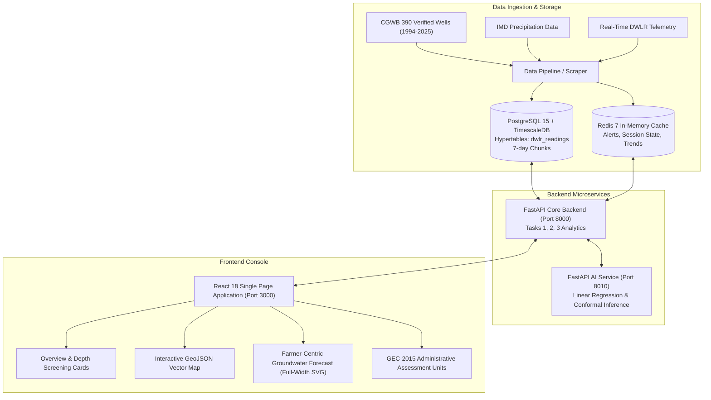

# JalDrishti — Groundwater Intelligence & Forecasting Platform

**National DWLR Telemetry Analytics, Statutory GEC-2015 Evaluation & Spatial-Temporal Aquifer Forecasting**  
*Addressing Central Ground Water Board (CGWB) Problem Statement #25068*  

[](https://www.python.org/)
[](https://react.dev/)
[](https://fastapi.tiangolo.com/)
[](https://www.timescale.com/)
[](https://redis.io/)
[](./LICENSE)

**Author & Project Lead:** Abhishek Jayagond  
**Repository:** [https://github.com/abhishekjayagond/JalDrishti](https://github.com/abhishekjayagond/JalDrishti)  
**Academic Reference:** [Comprehensive Defense Guide (PROJECT_DEFENSE_GUIDE.md)](./PROJECT_DEFENSE_GUIDE.md) | [Viva Question Bank (VIVA_QUESTIONS_AND_ANSWERS.md)](./VIVA_QUESTIONS_AND_ANSWERS.md)  

---

## Executive Summary

Groundwater provides **63% of India's total net irrigated agriculture area** and **85% of rural domestic drinking water supplies**. Under the World Bank-aided National Hydrology Project (NHP), the Central Ground Water Board (CGWB) has deployed over **5,260 automated Digital Water Level Recorders (DWLR)** across India. Transforming this high-frequency, noisy sensor stream into actionable, forward-looking intelligence has historically been hindered by fragmented data pipelines and inconsistent analytical frameworks.

**JalDrishti** provides an end-to-end, production-ready operational platform that bridges real-time telemetry ingestion, dynamic monsoon recharge modeling, statutory Ground Water Estimation Committee (GEC-2015) volumetric evaluations, and multi-year seasonal water table forecasting equipped with distribution-free conformal uncertainty intervals.

In its verified implementation baseline, JalDrishti operates on **390 verified real Karnataka CGWB observation wells** (with 32 years of annual pre-monsoon records spanning 1994–2025; 28,544 validated station-years) and **78 nationwide benchmark fallback stations** (covering 26 states for UI continuity), while providing ingestion pipelines ready to receive live continuous DWLR telemetry streams.

---

## Documentation & Viva Resources

For comprehensive technical evaluation, project viva defense, and architectural deep-dives, consult the authoritative documentation manuals:

- 📘 **[PROJECT_DEFENSE_GUIDE.md](./PROJECT_DEFENSE_GUIDE.md)**: Master technical manual across 15 mandatory sections covering national groundwater context, problem motivation, system architecture, database design, ML formulation, conformal calibration, and native Windows operational rationale.
- 🎯 **[VIVA_QUESTIONS_AND_ANSWERS.md](./VIVA_QUESTIONS_AND_ANSWERS.md)**: 105 in-depth, defensible questions and answers across 24 hydrogeological, algorithmic, and software engineering categories, including the critical *"Questions I Must Never Answer Incorrectly"* viva traps.
- 🛠️ **[LOCAL_SETUP.md](./LOCAL_SETUP.md)**: Native Windows local services installation and environment setup guide.

---

## Core Capabilities

### 1. Water Table Fluctuation (WTF) Analytics (Task 1)
- Ingests high-frequency sensor readings across monitoring stations.
- Computes hourly, daily, and weekly rate of rise/fall metrics with 7-day moving averages.
- Automated anomaly detection identifying sudden drops indicative of localized over-extraction ($v_d > 0.15\text{ m/day}$).
- Interactive geospatial vector cartography projecting station status across India.

### 2. Dynamic Monsoon Recharge Estimation (Task 2)
- Correlates water table recovery with India Meteorological Department (IMD) gridded precipitation data.
- Derives net recharge volumes and recharge rates (m/day) across distinct aquifer formations (Alluvial, Hard Rock, Basalt, Granite, Sandstone) using specific yield ($S_y$) coefficients.
- Detects recharge lag times and identifies critically stressed zones experiencing zero or negative seasonal recovery.

### 3. Aquifer Resource Evaluation & Statutory GEC-2015 Categorization (Task 3)
- **Statutory CGWB GEC-2015 Administrative Assessment-Unit Categorization**:
  - Evaluates administrative assessment units (Taluks / Blocks / Mandals) strictly based on the volumetric **Stage of Groundwater Extraction (SOE)**:
    $$\text{SOE (\%)} = \left( \frac{\text{Current Annual Groundwater Extraction for All Uses}}{\text{Net Annual Groundwater Availability}} \right) \times 100\%$$
  - Official Statutory Categories:
    - **Safe:** $\text{SOE} \le 70\%$
    - **Semi-Critical:** $70\% < \text{SOE} \le 90\%$
    - **Critical:** $90\% < \text{SOE} \le 100\%$
    - **Over-Exploited:** $\text{SOE} > 100\%$
  - Scientific Integrity Safeguards: Water level trends provide advisory diagnostic context but **never overwrite statutory volumetric SOE categories**. Unverified or missing SOE returns `unassessed`.
- **Operational Point-Level Depth Screening Tiers** (Field exploratory screening indicators for individual observation wells):
  - `0–8 m bgl`: High water table; centrifugal pumps operational.
  - `8–15 m bgl`: Moderate depth; submersible pumps recommended.
  - `15–25 m bgl`: Deep water table; increased energy consumption; cavitation risk.
  - `>25 m bgl`: Critical depletion; deep borehole required.
- **Non-Parametric Statistical Trend Diagnostics**:
  - Hamed & Rao (1998) Modified Mann-Kendall test correcting for autocorrelation variance inflation ($V^*(S)$).
  - Sen's slope estimator and exact 95% confidence intervals with tied-rank correction.
  - GEC-2015 guideline threshold sensitivity ($0.10–0.20\text{ m/year}$).

### 4. Machine Learning & Spatial-Temporal AI Forecasting (Task 4)
- Pre-monsoon groundwater level forecasting trained on 390 long-history Karnataka CGWB observation wells (1994–2025).
- **Strict 4-Way Chronological Split (Zero Data Leakage):**
  - Train: 1998–2016 ($n = 6,870$ samples). Fits regression weights and scalers.
  - Validation: 2017–2019 ($n = 1,074$ samples). Used for candidate model eligibility and selection.
  - Calibration: 2020, 2022 ($n = 406$ samples). Used strictly for conformal prediction non-conformity calibration.
  - Test Holdout: 2023–2025 ($n = 997$ samples). Completely unseen future evaluation.
- **Empirical Model Benchmarking:** Linear Regression selected as production served model with lowest validation and test error among eligible candidates:
  - Test RMSE: **2.50 m bgl**
  - Test MAE: **1.68 m bgl**
  - Test $R^2$: **0.55**
- **Split Conformal Prediction (Distribution-Free Uncertainty):**
  - Calibrated uncertainty radius $r = \mathbf{5.73\text{ m bgl}}$ at nominal 90% confidence.
  - Verified test coverage on unseen holdout: **96.39%** (2023: 97.77%, 2024: 96.15%, 2025: 95.02%).
- **Scientific Honesty on Forecasting Horizons:**
  - Pre-Monsoon 2026: Single-step empirical **hindcast** from 2025 data (calibrated uncertainty).
  - Pre-Monsoon 2027: Multi-step recursive **forecast** (uncertainty transparently marked as unavailable to prevent false precision).

### 5. Farmer-Centric UX & High-Contrast Visualization
- Intuitive 3-section page layout: Location Selector $\rightarrow$ Compact Forecast Summary $\rightarrow$ Full-Width Time-Series Graph $\rightarrow$ Collapsible Technical Reference.
- Custom SVG time-series engine with physically inverted vertical axis ($0\text{ m}$ at surface scaling downward to $25+\text{ m bgl}$), eliminating cognitive dissonance.
- High-contrast typography and clear depth badges for agricultural operators.

---

## Model Benchmark & Evaluation Matrix

All models were evaluated on the identical 997-sample holdout test partition (2023–2025):

| Candidate Architecture | Test MAE (m) | Test RMSE (m) | Test $R^2$ | Production Status | Scientific Rationale & Disqualification Reasons |
| :--- | :---: | :---: | :---: | :---: | :--- |
| **Linear Regression (OLS)** | **1.68** | **2.50** | **0.55** | **SELECTED** | **Lowest error among eligible candidates; deterministic; physically interpretable.** |
| **Random Forest Regressor** | 1.74 | 2.57 | 0.52 | Eligible | Robust ensemble, but slightly higher holdout error; cannot extrapolate continuous trends. |
| **Long Short-Term Memory (LSTM)** | 1.68 | 2.44 | 0.57 | Disqualified | Sequence starvation ($T \approx 25$ steps); missing year 2021 required artificial imputation; high initialization variance. |
| **Spatio-Temporal Graph Neural Net (STGNN)** | 2.49 | 3.20 | 0.26 | Disqualified | Spatial graph sparsity (wells 15–40 km apart across fractured bedrock); edge fabrication; over-smoothing. |
| **Persistence Baseline ($y_t = y_{t-1}$)** | 2.05 | 3.01 | 0.35 | Disqualified | Naive benchmark lacking multi-year lag weighting. |

---

## System Architecture



---

## Technology Stack & Native Windows Rationale

### Technology Stack
- **Frontend**: React 18, Semantic HTML5, Modular CSS design system, Responsive SVG vector visualization.
- **Backend APIs**: Python 3.10+, FastAPI, Uvicorn ASGI server, SQLAlchemy ORM, Pydantic data validation.
- **Database & Cache**: PostgreSQL 15 with TimescaleDB time-series extension (7-day hypertables), Redis 7 in-memory cache.
- **Machine Learning**: Scikit-Learn, Joblib, NumPy, SciPy, PyTorch.
- **Process Orchestration**: Native Windows PowerShell supervisor (`start-jaldrishti.ps1`, `stop-jaldrishti.ps1`).

### Why Native Windows Runtime over Docker?
JalDrishti intentionally migrated from Docker to a **native Windows runtime**:
1. **WSL2 & Hyper-V Resource Penalties:** Docker Desktop on Windows requires running a virtualized Linux kernel via WSL2 or Hyper-V, consuming 4–8 GB of RAM and continuous background CPU cycles, leaving standard 8–16 GB evaluation laptops starved for memory.
2. **Cross-OS Filesystem Latency:** Accessing project files across the Windows/WSL2 boundary (`/mnt/c/`) causes 5x–10x I/O slowdowns during React builds (`node_modules`) and database WAL writes.
3. **Port Bridging & WebSocket Stability:** Docker's NAT bridge frequently disconnects WebSocket live-reload connections.
4. **Boot Speed:** Native PowerShell startup takes **under 2.5 seconds** (PostgreSQL binary executes in 800ms, Redis in 200ms, FastAPI in 1.1s), compared to 35–70 seconds for Docker Compose.
5. **Direct Debugging & Offline Reliability:** Zero external container dependencies during university evaluations; works 100% offline without pulling multi-gigabyte images from Docker Hub.

---

## Quick Start (Native Windows)

### Prerequisites
- **Operating System:** Windows 10 or 11 (64-bit)
- **Python:** Version 3.10 or 3.11 installed and added to PATH
- **Node.js:** Version 18.x or 20.x LTS with npm
- **Git:** Standard Windows Git client
- **Local Services:** PostgreSQL 15 and Redis 7 binaries in `.local_services/`

---

### Single-Command Automated Startup

Open Windows PowerShell in the repository root:

```powershell
# Start all services: PostgreSQL, Redis, Backend, AI Service, and React Frontend
.\start-jaldrishti.ps1
```

The script automatically:
1. Validates Python virtual environment and Node.js runtimes.
2. Starts native PostgreSQL (TimescaleDB) on port `5432` from `.local_services/`.
3. Starts native Redis on port `6379` from `.local_services/`.
4. Launches FastAPI Core Backend on `http://localhost:8000`.
5. Launches FastAPI AI Service on `http://localhost:8010`.
6. Launches React Web Console on `http://localhost:3000`.
7. Monitors health endpoints and opens `http://localhost:3000` in the default browser.

### Clean Process Termination

To gracefully stop all background services without affecting unrelated processes:

```powershell
.\stop-jaldrishti.ps1
```

---

## Automated Testing & Quality Assurance

JalDrishti includes comprehensive automated tests covering all system layers:

```powershell
# 1. Run Backend & Algorithm Tests (41 tests)
.\.venv\Scripts\python.exe -m pytest backend/tests

# 2. Run AI Forecasting Pipeline Tests (10 tests)
.\.venv\Scripts\python.exe -m pytest ai/tests

# 3. Run Frontend Automated Component Tests (13 tests)
npm test --prefix frontend -- --watchAll=false

# 4. Run Frontend Production Build Verification
npm run build --prefix frontend

# 5. Run Monte Carlo Statistical Simulation Suite (1,000 iterations across 6 scenarios)
.\.venv\Scripts\python.exe backend/algorithms/validate_trend_simulations.py
```

---

## REST API Reference

| Endpoint | Method | Description |
| :--- | :---: | :--- |
| `/health` | `GET` | Core system health and service status |
| `/api/stations/` | `GET` | Query monitoring stations with state/district filters |
| `/api/stations/{id}` | `GET` | Detailed station metadata and recent readings |
| `/api/stations/{id}/readings` | `GET` | Historical time-series telemetry data |
| `/api/task1/fluctuation` | `GET` | Water table fluctuation analytics (7-day MA, rate) |
| `/api/task1/anomalies` | `GET` | Active rapid drawdown anomalies and pump warnings |
| `/api/task2/recharge` | `GET` | Dynamic rainfall recharge estimate via WTF method |
| `/api/task3/evaluation` | `GET` | Assessment unit statutory GEC-2015 evaluation & SOE |
| `/api/task3/units` | `GET` | Registry of all statutory assessment units |
| `/api/ai/forecast` | `GET` | Pre-monsoon water table forecast with conformal bounds |
| `/api/ai/metrics` | `GET` | Audited model performance metrics and split details |

---

## Authoritative Data Sources

- **Central Ground Water Board (CGWB)**: Published hydrological yearbooks (*"Pre-monsoon Water Level Data 1994–2025"*), GEC-2015 assessment norms, and hydrogeological formation specific yield values.
- **National Hydrology Project (NHP)**: Automated Digital Water Level Recorder (DWLR) network telemetry protocols and piezometer configurations.
- **India Meteorological Department (IMD)**: Gridded daily precipitation dataset ($0.25^\circ \times 0.25^\circ$).

---

## License & Ownership

- **Project:** JalDrishti  
- **Lead Developer & Author:** Abhishek Jayagond  
- **Repository:** [https://github.com/abhishekjayagond/JalDrishti](https://github.com/abhishekjayagond/JalDrishti)  
- **License:** [MIT License](./LICENSE)  
- **Copyright:** © 2026 Abhishek Jayagond. All Rights Reserved.
